# 🎓 Web Hướng Nghiệp – THPT Chuyên Biên Hòa – Hà Nam

> Hệ thống hướng nghiệp STEM tích hợp: Trắc nghiệm Holland RIASEC + Đa trí tuệ, Tra cứu Xét tuyển Đại học, Bản tin, Bản đồ Kỹ năng và Bookmark yêu thích.

> **Trạng thái 19/10/2026:** Đã có khung backend **Java 21 + Spring Boot + PostgreSQL**, migration Flyway, quiz có phiên bản, API quản trị, hồ sơ/yêu thích và luồng Holland → đề xuất ngành. Frontend hỗ trợ chế độ demo và kết nối backend. Đăng nhập Google đã có luồng xử lý, cần cấu hình Client ID/Secret để sử dụng thực tế. **Excel được hoãn sang đợt sau.** Đây là nền tảng phát triển, chưa phải bản phát hành production hoàn chỉnh.
>
> **Chạy và cấu hình:** [Hướng dẫn phát triển](docs/DEVELOPMENT.md) · [Phạm vi khung đã triển khai và các bước tiếp theo](docs/IMPLEMENTATION.md).
>
> **Tài liệu nâng cấp:** [Phạm vi](#upgrade-scope) · [Kiến trúc](#upgrade-architecture) · [Cấu trúc OOP](#upgrade-oop) · [Database và ERD](#upgrade-database) · [Luồng nghiệp vụ](#upgrade-flows) · [API](#upgrade-api) · [Lộ trình và nghiệm thu](#upgrade-roadmap).

[](https://react.dev)
[](https://typescriptlang.org)
[](https://tailwindcss.com)
[](https://vitejs.dev)

---

## 📋 Mục lục

- [Tính năng](#-tính-năng)
- [Yêu cầu cài đặt](#-yêu-cầu-cài-đặt)
- [Chạy nhanh – Frontend Only](#-chạy-nhanh--frontend-only-khuyên-dùng)
- [Cấu trúc dự án](#-cấu-trúc-dự-án)
- [Danh sách trang & URL](#-danh-sách-trang--url)
- [Công nghệ sử dụng](#-công-nghệ-sử-dụng)
- [Đóng góp](#-đóng-góp)

---

## ✨ Tính năng

| # | Tính năng | Mô tả |
|---|---|---|
| 1 | 🧠 **Trắc nghiệm Holland RIASEC** | 24 câu · 6 nhóm tính cách · cho ra Mã Holland 3 chữ cái + biểu đồ mạng nhện + danh sách nghề phù hợp |
| 2 | 💡 **Trắc nghiệm Đa trí tuệ (MI)** | 40 câu · 8 loại trí tuệ (Howard Gardner) · gợi ý ngành STEM phù hợp |
| 3 | 📊 **Tra cứu Xét tuyển ĐH** | Nhập điểm → dự báo cơ hội 4 phương thức (THPT, ĐGNL, Học bạ + IELTS, HSG) tại 10+ trường top |
| 4 | ❤️ **Bookmark yêu thích** | Lưu nghề nghiệp / ngành học / trường ĐH để so sánh sau (lưu local, không cần đăng nhập) |
| 5 | 📰 **Bản tin hướng nghiệp** | Tin tức tuyển sinh, học bổng, sự kiện STEM |
| 6 | 🗺️ **Bản đồ Kỹ năng STEM** | Lộ trình học kỹ năng theo ngành + link khóa học Coursera / edX / YouTube miễn phí |
| 7 | 🔗 **Link tuyển sinh chính thức** | Liên kết trực tiếp đến cổng Bộ GD&ĐT, các trường ĐH, học bổng |

---

## 🛠 Yêu cầu cài đặt

| Công cụ | Phiên bản tối thiểu | Kiểm tra |
|---|---|---|
| **Node.js** | v18 trở lên | `node -v` |
| **pnpm** *(khuyên dùng)* | v8 trở lên | `pnpm -v` |
| **npm** *(thay thế)* | v9 trở lên | `npm -v` |
| **Git** | Bất kỳ | `git -v` |

> 💡 **Cài pnpm** (nếu chưa có): `npm install -g pnpm`

---

## 🚀 Chạy nhanh – Frontend Only *(khuyên dùng)*

> Chế độ demo (`VITE_USE_BACKEND=false`) không cần backend/database; sử dụng dữ liệu có sẵn. Để dùng tài khoản, quản trị và dữ liệu tập trung, xem [hướng dẫn backend](docs/DEVELOPMENT.md). Các liên kết, tài nguyên bên ngoài và tải ứng dụng lần đầu vẫn cần mạng.

### Bước 1 – Clone dự án

```bash
git clone https://github.com/HaiDo2409/webhuongnghiep.git
cd webhuongnghiep
```

### Bước 2 – Vào thư mục frontend

```bash
cd frontend
```

### Bước 3 – Cài thư viện *(chỉ lần đầu)*

```bash
# Dùng pnpm (nhanh hơn, khuyên dùng)
pnpm install

# Hoặc dùng npm
npm install
```

### Bước 4 – Khởi chạy

```bash
# Dùng pnpm
pnpm dev

# Hoặc npm
npm run dev
```

### Bước 5 – Mở trình duyệt

Truy cập: **http://localhost:5173**

> Để dừng server: nhấn **Ctrl + C** trong terminal.

---

## 📁 Cấu trúc dự án

```
webhuongnghiep/
├── frontend/                        # Toàn bộ giao diện React
│   ├── src/
│   │   ├── App.tsx                  # Cấu hình Routes chính
│   │   ├── layouts/
│   │   │   └── MainLayout.tsx       # Header + Nav bar + Footer dùng chung
│   │   ├── pages/
│   │   │   ├── index.tsx            # Trang chủ
│   │   │   ├── trac-nghiem/         # Trắc nghiệm Holland & Đa trí tuệ
│   │   │   │   ├── index.tsx        # Trang trắc nghiệm (tab Holland / MI)
│   │   │   │   ├── MIQuiz.tsx       # Component trắc nghiệm Đa trí tuệ
│   │   │   │   ├── CareerResults.tsx# Kết quả nghề nghiệp + Bookmark
│   │   │   │   ├── HollandRadarChart.tsx
│   │   │   │   └── data/
│   │   │   │       ├── questions.ts # 24 câu Holland RIASEC
│   │   │   │       ├── mi-questions.ts # 40 câu Đa trí tuệ
│   │   │   │       └── careers.ts   # Danh sách nghề nghiệp
│   │   │   ├── xet-tuyen/           # Tra cứu xét tuyển
│   │   │   │   ├── index.tsx
│   │   │   │   └── data/
│   │   │   │       ├── schools.ts   # Dữ liệu 10+ trường ĐH
│   │   │   │       └── scoring.ts   # Thuật toán tính điểm 4 phương thức
│   │   │   ├── ban-tin/             # Bản tin hướng nghiệp
│   │   │   ├── ky-nang/             # Bản đồ kỹ năng STEM
│   │   │   │   └── data/skills.ts  # Lộ trình kỹ năng + links
│   │   │   ├── bookmarks/           # Trang yêu thích đã lưu
│   │   │   ├── login/               # Đăng nhập Google OAuth
│   │   │   └── dashboard/           # Dashboard (sau đăng nhập)
│   │   ├── hooks/
│   │   │   └── useBookmarks.ts      # Hook lưu yêu thích (localStorage)
│   │   ├── lib/
│   │   │   └── routes.ts            # Hằng số đường dẫn URL
│   │   └── components/
│   │       └── ui/                  # shadcn/ui components
│   ├── package.json
│   ├── vite.config.ts
│   └── tsconfig.json
└── README.md
```

---

## 🌐 Danh sách trang & URL

| Trang | URL | Ghi chú |
|---|---|---|
| 🏠 Trang chủ | `/` | Giới thiệu tổng quan |
| 🧠 Trắc nghiệm | `/trac-nghiem` | Tab Holland RIASEC + Đa trí tuệ |
| 📊 Tra cứu XTS | `/xet-tuyen` | Nhập điểm → xem cơ hội |
| 📰 Bản tin | `/ban-tin` | Tin tức & sự kiện |
| 🗺️ Bản đồ Kỹ năng | `/ky-nang` | Lộ trình STEM + Links |
| ❤️ Yêu thích | `/yeu-thich` | Nghề / ngành đã bookmark |
| 🔐 Đăng nhập | `/login` | Google OAuth |
| 👤 Dashboard | `/dashboard` | Yêu cầu đăng nhập |

---

## 🏗 Các lệnh khác

```bash
# Build cho production
pnpm build
# hoặc: npm run build
# → Tạo thư mục frontend/dist/ để deploy

# Xem trước bản build production
pnpm preview
# hoặc: npm run preview

# Kiểm tra lỗi TypeScript
pnpm tsc --noEmit

# Kiểm tra lint
pnpm lint

# Format code (Prettier)
pnpm format
```

---

## ⚙️ Công nghệ sử dụng

| Công nghệ | Vai trò |
|---|---|
| **React 19** | UI framework |
| **TypeScript 6** | Type-safe code |
| **Vite 8** | Build tool, dev server siêu nhanh |
| **Tailwind CSS 4** | Utility-first styling |
| **shadcn/ui** | UI components (Button, Badge, Select...) |
| **React Router v7** | Client-side routing |
| **Recharts** | Biểu đồ mạng nhện (Radar Chart) |
| **Lucide React** | Icon library |
| **localStorage** | Lưu bookmark yêu thích (không cần DB) |

---

## 🤝 Đóng góp

1. Fork dự án
2. Tạo nhánh mới: `git checkout -b ten-tinh-nang`
3. Commit thay đổi: `git commit -m "mo-ta-ngan-gon"`
4. Push lên nhánh: `git push origin ten-tinh-nang`
5. Tạo Pull Request

---

## 📄 Giấy phép

Dự án phục vụ mục đích học tập và hướng nghiệp tại THPT Chuyên Biên Hòa – Hà Nam.  
Không sử dụng cho mục đích thương mại.

---

<div align="center">
  Made with ❤️ by học sinh THPT Chuyên Biên Hòa – Hà Nam
</div>

---

<a id="upgrade-scope"></a>

## 1. Kế hoạch nâng cấp thành website hoàn chỉnh

**Ngày lập:** 19/10/2026. **Trạng thái:** Kiến trúc mục tiêu; một phần đã được triển khai thành khung. Xem [bảng đối chiếu thực tế](docs/IMPLEMENTATION.md). Các mục Excel là kế hoạch cho đợt sau.

Các hướng dẫn demo ở trên vẫn áp dụng. Các sơ đồ và mô hình chuẩn hóa bên dưới mô tả kiến trúc đích, không phải cam kết mọi API/bảng đã tồn tại. Khung hiện dùng JSONB có kiểm tra cho câu hỏi, hồ sơ Holland, snapshot và danh mục giai đoạn đầu; migration thực tế là nguồn xác định schema hiện hành. Các sơ đồ sử dụng Mermaid.

### 1.1. Mục tiêu và phạm vi

| Yêu cầu | Kết quả cần đạt |
|---|---|
| Database tập trung | Lưu tài khoản, hồ sơ, quiz, kết quả, nghề, ngành, trường và tuyển sinh |
| Tài khoản Google | Đăng nhập thực tế, tạo phiên, lưu dữ liệu giữa các thiết bị |
| Quản trị nội dung | Admin thêm/sửa/xuất bản quiz, nghề, ngành, trường và điểm chuẩn |
| Cá nhân hóa | Kết quả quiz ảnh hưởng bộ lọc, thứ tự và giải thích đề xuất xét tuyển |
| Excel | Học sinh xuất báo cáo cá nhân; admin nhập/xuất dữ liệu theo quyền |
| Vận hành | Phân quyền, nhật ký, theo dõi lỗi, sao lưu và khôi phục |

**Nguyên tắc quan trọng:** Quiz thay đổi mức phù hợp và thứ tự gợi ý; không được cộng vào điểm xét tuyển hoặc thay đổi quy định của trường. Điểm tương đồng hướng nghiệp không phải xác suất trúng tuyển.

### 1.2. Hiện trạng và phần cần chuyển đổi

| Hiện tại | Mục tiêu |
|---|---|
| Câu hỏi trong `frontend/src/pages/trac-nghiem/data/` | Backend cung cấp phiên bản quiz đã xuất bản |
| Nghề, ngành/trường khai báo trong mã | Database và giao diện quản trị |
| Tính điểm trong `frontend/src/pages/xet-tuyen/data/scoring.ts` | Dịch vụ tính theo quy tắc từng năm/chương trình |
| `AuthProvider` gọi `/api/users/me`, dev trả dữ liệu giả lập | Xác thực Google và phiên thật |
| Bookmark trong localStorage | Đồng bộ database; hỗ trợ hợp nhất dữ liệu khách |
| Bản tin và kỹ năng chủ yếu tĩnh | Nội dung được quản lý, có nguồn và ngày cập nhật |
| Quiz và tra cứu riêng biệt | Dùng chung hồ sơ người dùng và mô hình nghề–ngành |
| Khung khóa học/editor có sẵn | Giữ riêng; hoàn thiện LMS không thuộc phạm vi đợt này |

Dữ liệu hiện tại chỉ là đầu vào cho đợt nhập ban đầu. Phải rà soát nguồn, năm, mã ngành, phương thức và công thức trước khi công bố. Không chuyển nhãn “phần trăm cơ hội” hiện tại thành xác suất đỗ chính thức.

### 1.3. Vai trò và quyền

| Chức năng | Khách | Học sinh | Admin |
|---|---|---|---|
| Xem nghề/ngành/trường, tra cứu công khai | Có | Có | Có |
| Làm quiz | Phiên tạm | Có lưu lịch sử | Có |
| Xem/sửa hồ sơ cá nhân | Không | Của mình | Của mình |
| Xuất báo cáo cá nhân | Không | Của mình | Của mình |
| Sửa/xuất bản dữ liệu | Không | Không | Theo quyền |
| Nhập/xuất danh mục Excel | Không | Không | Theo quyền |
| Xem thống kê tổng hợp | Không | Không | Theo quyền |
| Xuất dữ liệu cá nhân của học sinh | Không | Không | Quyền riêng, có nhật ký |
| Cấp quyền/khóa tài khoản | Không | Không | Quyền quản lý người dùng |

Đăng ký mới mặc định là học sinh. Admin đầu tiên được tạo qua tác vụ khởi tạo có kiểm soát; không có API công khai tự nhận quyền admin. Backend kiểm tra cả quyền chức năng và quyền sở hữu dữ liệu. Có thể bổ sung biên tập viên bằng các quyền hiện có, không cần tạo cây kế thừa tài khoản.

<a id="upgrade-architecture"></a>

## 2. Kiến trúc hệ thống đề xuất

### 2.1. Công nghệ và ranh giới trách nhiệm

| Thành phần | Đề xuất | Trách nhiệm |
|---|---|---|
| Frontend | React + TypeScript + Vite hiện tại | Giao diện công khai, học sinh và admin |
| Backend | Java + Spring Boot, Maven | API, xác thực, nghiệp vụ, kiểm tra quyền |
| Database | PostgreSQL | Dữ liệu quan hệ và giao dịch |
| ORM | Spring Data JPA + Hibernate | Repository, ánh xạ dữ liệu và giao dịch |
| Migration | Flyway | Thay đổi schema PostgreSQL có phiên bản |
| Xác thực | Spring Security OAuth2 Client + Google OpenID Connect | Authorization Code Flow và phiên backend |
| Lưu phiên | Spring Session JDBC trên PostgreSQL | Quản lý thời hạn và thu hồi phiên |
| Excel | Apache POI phía backend | Đọc/ghi `.xlsx`, kiểm tra, nhập và báo cáo |
| Kho file | Object storage | Ảnh, tài liệu nguồn và file xuất có thời hạn |
| Triển khai | Một backend chia module | Đơn giản hóa vận hành và giao dịch |

Backend là nguồn xác thực cuối cùng cho quyền, chấm quiz và tính điểm. Trình duyệt không truy cập database trực tiếp. Chưa cần microservices; tác vụ nhập/xuất nhỏ có thể chạy trong backend, bổ sung worker khi khối lượng tăng.

### 2.2. Sơ đồ kiến trúc tổng thể

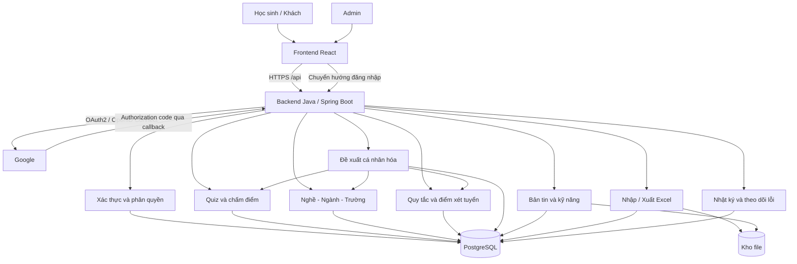

### 2.3. Tổ chức thư mục dự kiến

```text
webhuongnghiep/
├── frontend/                         # Có sẵn; chuyển dần sang API thật
│   └── src/
│       ├── pages/                    # Trang công khai và khu vực học sinh
│       ├── features/admin/           # Quản trị theo từng nghiệp vụ
│       ├── services/                 # Hàm gọi API, không chứa luật chấm điểm
│       ├── hooks/
│       ├── components/
│       └── types/                    # Hợp đồng dữ liệu phía trình duyệt
├── backend/                          # Sẽ tạo
│   ├── pom.xml                       # Dependency và build Maven
│   ├── mvnw / mvnw.cmd                # Maven Wrapper
│   └── src/
│       ├── main/
│       │   ├── java/vn/edu/huongnghiep/ # Package dự kiến
│       │   │   ├── CareerGuidanceApplication.java
│       │   │   ├── config/            # Security, session, JPA, CORS
│       │   │   ├── modules/
│       │   │   │   ├── auth/
│       │   │   │   ├── users/
│       │   │   │   ├── profiles/
│       │   │   │   ├── quizzes/
│       │   │   │   ├── careers/
│       │   │   │   ├── majors/
│       │   │   │   ├── universities/
│       │   │   │   ├── admissions/
│       │   │   │   ├── recommendations/
│       │   │   │   ├── bookmarks/
│       │   │   │   ├── content/
│       │   │   │   ├── datatransfer/  # Import/export Excel
│       │   │   │   └── audit/
│       │   │   ├── shared/            # Lỗi, giao dịch, bảo mật, phân trang
│       │   │   └── infrastructure/    # JPA, Google, storage, telemetry
│       │   └── resources/
│       │       ├── application.yml
│       │       ├── application-dev.yml
│       │       ├── application-prod.yml
│       │       └── db/migration/      # Flyway: V1__initial_schema.sql...
│       └── test/
│           ├── java/vn/edu/huongnghiep/
│           └── resources/
├── docs/                             # Đặc tả API, mẫu Excel, quy tắc dữ liệu
├── infra/                            # Cấu hình triển khai và sao lưu
└── README.md
```

Một module nghiệp vụ có cấu trúc:

```text
quizzes/
├── presentation/
│   ├── QuizController.java
│   ├── AdminQuizController.java
│   └── dto/                         # Request/response, Jakarta Validation
├── application/
│   ├── QuizApplicationService.java  # Điều phối use case và transaction
│   └── port/QuizRepository.java     # Cổng truy cập dữ liệu
├── domain/
│   ├── model/                       # QuizVersion, QuizAttempt, Question
│   └── scoring/                     # Interface và các strategy chấm điểm
└── infrastructure/persistence/
    ├── entity/                      # JPA entity ánh xạ bảng
    ├── SpringDataQuizRepository.java
    ├── JpaQuizRepositoryAdapter.java
    └── QuizPersistenceMapper.java
```

<a id="upgrade-oop"></a>

## 3. Thiết kế OOP

### 3.1. Nguyên tắc thiết kế

- **Đóng gói:** Entity bảo vệ trạng thái; bài đã nộp không nhận thêm đáp án, quiz đã xuất bản không sửa trực tiếp.
- **Trừu tượng:** Nghiệp vụ phụ thuộc interface repository/storage/identity thay vì Hibernate hoặc Google trực tiếp.
- **Đa hình:** Strategy riêng cho Holland, Đa trí tuệ và từng loại tính điểm xét tuyển.
- **Kế thừa có giới hạn:** Dùng interface/abstract contract cho hành vi thay đổi; không tạo `Admin extends Student`.
- **Ưu tiên kết hợp:** `User` có tập quyền; `RecommendationService` kết hợp kết quả nhiều dịch vụ.
- **Một trách nhiệm:** Chấm quiz, tính xét tuyển, xếp hạng và xuất Excel là các phần riêng.
- **Đảo ngược phụ thuộc:** Service nhận dependency bằng constructor; Spring IoC gắn implementation qua bean, dùng `@Qualifier` hoặc registry khi có nhiều strategy.

React tiếp tục dùng function component và hooks. OOP chủ yếu áp dụng ở backend và miền nghiệp vụ; không cần đổi toàn bộ frontend sang class component.

### 3.2. Các tầng và hướng phụ thuộc

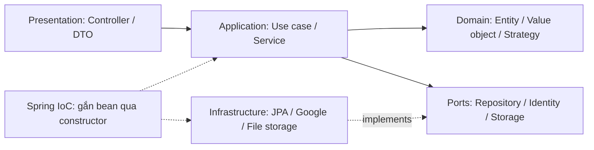

Controller nhận yêu cầu, kiểm tra DTO bằng Jakarta Validation và chuyển cho use case. Application service điều phối giao dịch qua `@Transactional`, quyền và nghiệp vụ. Domain là Java thuần, không import Spring/JPA. JPA entity thuộc tầng persistence; adapter chuyển entity sang domain qua mapper. Spring Data repository là chi tiết triển khai, không được truyền trực tiếp lên controller. Dùng `BigDecimal` cho điểm/học phí và `@Version` ở JPA entity cần chống ghi đè đồng thời.

### 3.3. Danh sách lớp và trách nhiệm

| Lớp / Interface | Trách nhiệm |
|---|---|
| `User`, `PermissionSet` | Trạng thái tài khoản và kiểm tra quyền |
| `OAuth2UserProvisioningService`, `SecurityConfig`, `SessionAccessService` | Liên kết danh tính Google, cấu hình Spring Security, thu hồi phiên qua Spring Session |
| `QuizVersion`, `Question`, `AnswerOption` | Cấu hình bài đánh giá và kiểm tra khả năng xuất bản |
| `QuizAttempt` | Ghi đáp án, trạng thái bài và quy tắc nộp bài |
| `QuizScoringStrategy` | Hợp đồng chấm điểm, có mã phiên bản thuật toán |
| `HollandScoringStrategy`, `MIScoringStrategy` | Chấm từng loại quiz và chuẩn hóa điểm |
| `QuizApplicationService` | Bắt đầu, lưu, nộp bài và lưu kết quả trong giao dịch |
| `MajorInterestProfile`, `InterestProfile` | Hồ sơ sáu nhóm của ngành và học sinh |
| `AdmissionRuleVersion`, `ScoreProfile` | Quy tắc tuyển sinh và đầu vào học sinh |
| `AdmissionCalculator` | Hợp đồng tính một phương thức xét tuyển |
| `THPTCalculator`, `HSACalculator`, `TSACalculator` | Xử lý phương thức theo cấu hình đã kiểm chứng |
| `EligibilityPolicy` | Kiểm tra điều kiện, trả về đủ/không đủ/chưa đủ dữ liệu |
| `AdmissionService` | Chọn bộ tính, quy tắc và mốc đối chiếu đúng năm |
| `CompatibilityCalculator` | Tính độ phù hợp giữa hồ sơ học sinh và ngành |
| `RecommendationService`, `RankingPolicy` | Kết hợp dữ liệu, sắp xếp, tạo lý do đề xuất |
| `ExcelImportService`, `ImportValidator` | Đọc file, kiểm tra, xem trước, xác nhận nhập |
| `ExcelExportService`, `ExportAuthorizationPolicy` | Xuất đúng bộ lọc và phạm vi dữ liệu |
| `AuditService` | Ghi sự kiện quản trị, nhập/xuất và thay đổi quyền |

Các hợp đồng được khai báo bằng Java interface; Spring quản lý implementation qua `@Service`, `@Repository` hoặc `@Bean`. Registry chọn strategy theo loại quiz/phương thức và phiên bản đã hỗ trợ, không tra bean tùy ý từ dữ liệu người dùng. Dùng Java enum cho trạng thái và DTO/record cho dữ liệu truyền tải; không trả JPA entity trực tiếp qua API. Các lớp trên là hợp đồng thiết kế; tên cụ thể có thể điều chỉnh khi triển khai.

### 3.4. Sơ đồ lớp: Quiz

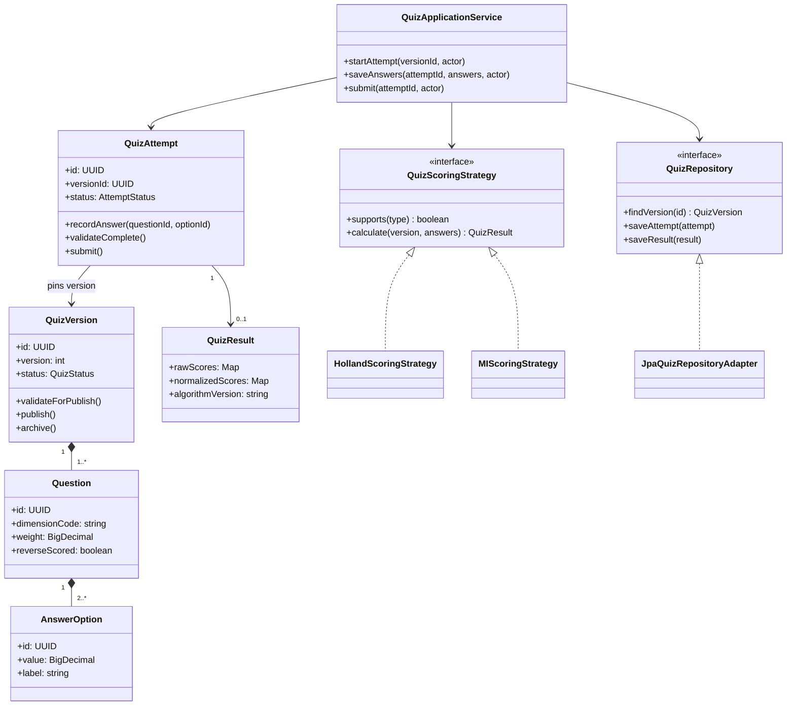

### 3.5. Sơ đồ lớp: Xét tuyển và đề xuất

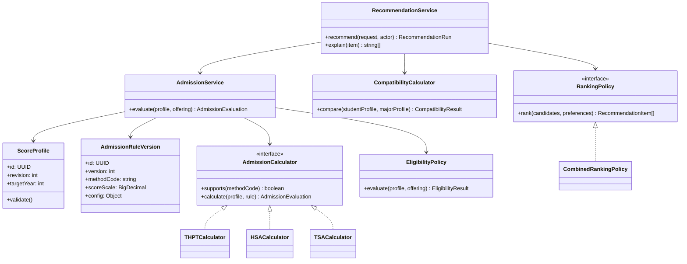

Quy tắc tuyển sinh cấu hình bằng schema có kiểm tra: môn, hệ số, giới hạn, quy đổi, điều kiện và ưu tiên. Không cho admin nhập mã JavaScript/SQL tùy ý. Phương thức hoàn toàn mới cần bộ tính mới cùng bộ kiểm thử, không chỉ thêm tên trong daabase.

<a id="upgrade-database"></a>

## 4. Thiết kế database và sơ đồ quan hệ

### 4.1. Quy ước chung

- Khóa chính UUID; thời gian lưu UTC, hiển thị theo múi giờ Việt Nam.
- Điểm dùng kiểu số thập phân có độ chính xác xác định; quy định rõ bước làm tròn.
- Mã ngành/mã tuyển sinh là chuỗi để giữ số 0 ở đầu.
- Bảng nghiệp vụ có `created_at`, `updated_at`; nội dung quản trị có người tạo/cập nhật.
- Nội dung công khai có trạng thái nháp/xuất bản/lưu trữ, nguồn và thời điểm xác minh.
- Bản ghi đã được lịch sử tham chiếu không xóa cứng tùy tiện; dùng lưu trữ hoặc phiên bản mới.
- Khóa ngoại, unique constraint và transaction bảo vệ dữ liệu bên cạnh kiểm tra ở ứng dụng.
- JSON chỉ dùng cho cấu hình/snapshot có schema; quan hệ nghiệp vụ chính dùng khóa ngoại.

### 4.2. ERD tài khoản, hồ sơ, quiz

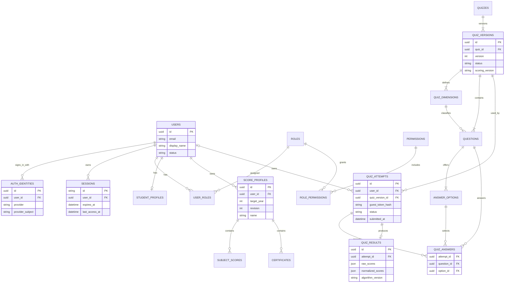

`SESSIONS` trong ERD là mô hình logic. Khi triển khai dùng các bảng `SPRING_SESSION` và `SPRING_SESSION_ATTRIBUTES` của Spring Session JDBC, không tự xây kho token phiên song song. Ánh xạ principal về UUID người dùng; thu hồi phiên qua Spring Session API và kiểm tra trạng thái/quyền hiện hành ở backend. Schema Spring Session được đưa vào migration Flyway, không để nhiều cơ chế tự tạo bảng cùng lúc.

`QUIZ_ATTEMPTS.user_id` có thể rỗng cho khách: dùng token ngẫu nhiên được băm, có thời hạn và giới hạn số lượt. Khi lưu vào tài khoản, backend kiểm tra quyền sở hữu phiên tạm và chấm lại. Không tin cậy điểm do localStorage gửi lên.

Ràng buộc: duy nhất `(provider, provider_subject)`, `(quiz_id, version)`, `(attempt_id, question_id)` và một kết quả cho mỗi bài nộp. Đáp án phải thuộc câu hỏi và cùng phiên bản bài làm. Quy tắc liên bảng cần được kiểm tra trong giao dịch hoặc ràng buộc database phù hợp.

### 4.3. ERD nghề, ngành và tuyển sinh

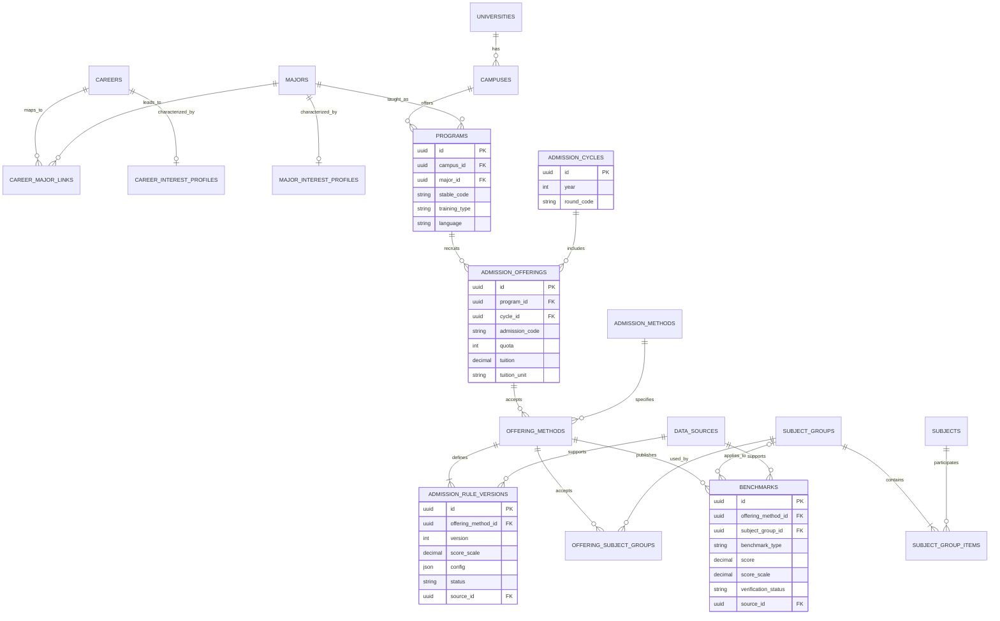

**Phân biệt dữ liệu:** Nghề là công việc; ngành là lĩnh vực đào tạo; chương trình là ngành tại trường/cơ sở với hình thức cụ thể; đợt tuyển sinh là chương trình trong năm/đợt xác định.

`benchmark_type` phân biệt điểm trúng tuyển và ngưỡng nhận hồ sơ. Dự báo được lưu riêng với phiên bản mô hình, không ghi đè điểm chính thức. `DATA_SOURCES` lưu URL/tài liệu, đơn vị công bố, ngày công bố, ngày kiểm tra và người xác minh.

Ràng buộc chống trùng theo chương trình, năm/đợt, phương thức, nhóm áp dụng và loại điểm. Với tổ hợp rỗng cần chỉ mục unique xử lý `NULL` rõ ràng. Quy tắc chỉ được dùng khi đã xuất bản; một phương thức chỉ có một phiên bản hiệu lực tại cùng thời điểm áp dụng.

### 4.4. ERD cá nhân hóa, nội dung và vận hành

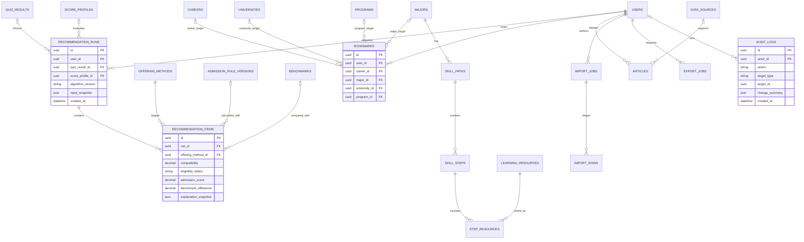

Bookmark dùng `CHECK` bảo đảm đúng một khóa đích khác rỗng và unique theo người dùng/đích. Không dùng `target_id` tự do cho bookmark vì sẽ mất khóa ngoại. Nhật ký có thể dùng định danh đích tổng quát vì cần tồn tại sau khi đối tượng đã được lưu trữ/xóa theo chính sách.

Lượt đề xuất lưu snapshot đầu vào, phiên bản hồ sơ điểm, quy tắc, mốc đối chiếu và hồ sơ phù hợp ngành đã dùng. Khi admin sửa dữ liệu, báo cáo cũ vẫn giải thích được. Khách có thể tra cứu tạm không lưu lịch sử dài hạn.

<a id="upgrade-flows"></a>

## 5. Luồng nghiệp vụ và vòng đời dữ liệu

### 5.1. Đăng nhập Google

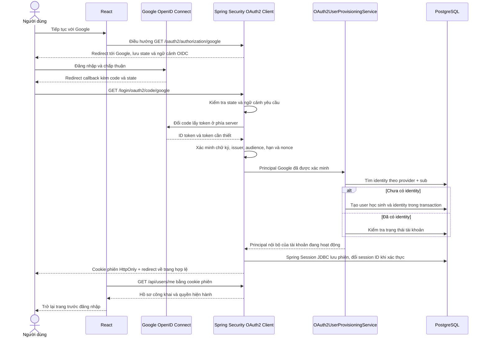

Không tự liên kết hai tài khoản chỉ vì trùng email. Google `sub` là định danh liên kết. Dùng Spring Security OAuth2 Login với Authorization Code Flow và OpenID Connect; React không nhận ID token để tự tạo phiên. Chỉ yêu cầu scope đăng nhập cần thiết (`openid`, `profile`, `email`), không yêu cầu quyền Drive/Gmail. Client secret chỉ nằm ở backend. Không lưu token phiên trong localStorage; cookie dùng Secure, HttpOnly, SameSite phù hợp và có bảo vệ CSRF cho thao tác thay đổi dữ liệu. Đăng xuất, khóa tài khoản và đổi quyền phải được phản ánh ở các yêu cầu tiếp theo. Chỉ cho phép URL trở về nằm trong danh sách nội bộ để tránh open redirect.

### 5.2. Admin cập nhật quiz

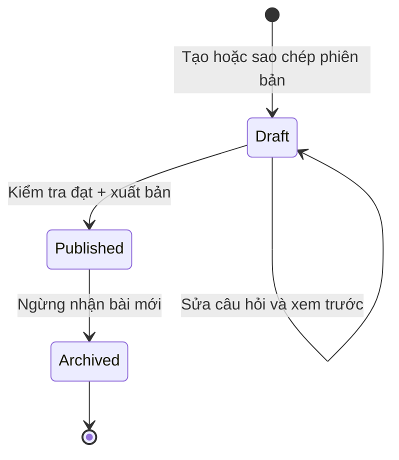

Phiên bản đã xuất bản là bất biến về nội dung/cách chấm. Muốn sửa phải sao chép thành bản nháp mới. Xuất bản phiên bản mới có thể đồng thời lưu trữ phiên bản cũ trong transaction. Bài đang làm tiếp tục gắn bản đã bắt đầu; bài hoàn thành giữ nguyên kết quả cũ.

Kiểm tra trước xuất bản: đủ nhóm/câu hỏi, lựa chọn hợp lệ, thang điểm, trọng số, công thức chuẩn hóa và diễn giải. Admin được chỉnh nội dung trong loại quiz đã hỗ trợ; loại quiz có công thức mới cần strategy và kiểm thử mới.

### 5.3. Làm bài và lưu kết quả

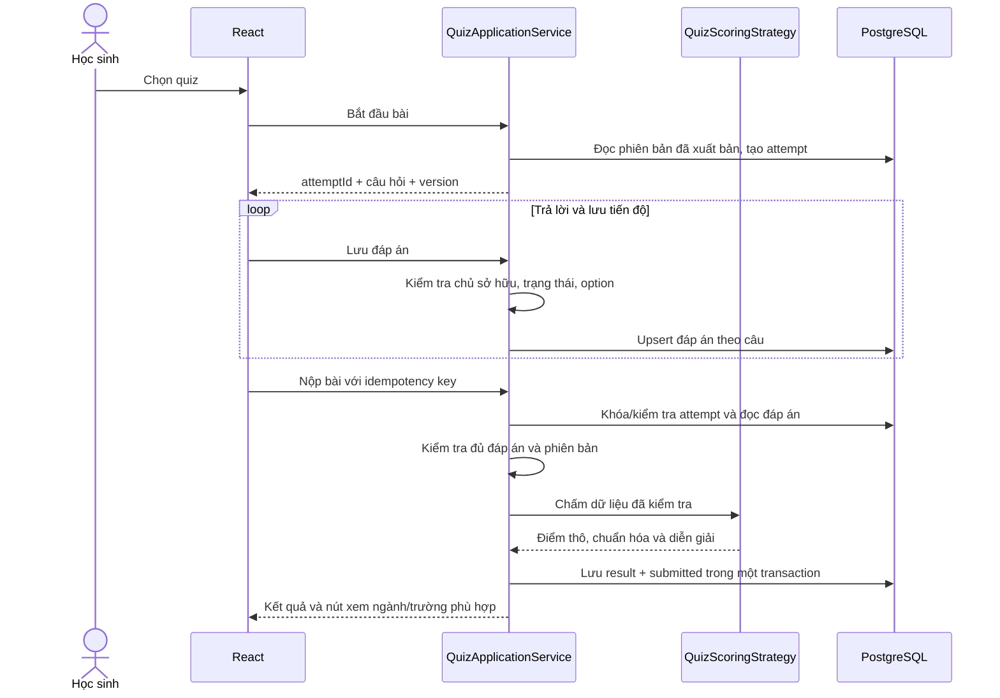

Nộp lặp trả lại cùng kết quả, không tạo nhiều kết quả. Không có cơ chế ngầm gán điểm trung bình cho câu chưa trả lời. Khách dùng phiên tạm; hết hạn thì dọn dữ liệu theo chính sách. Khi quiz đổi phiên bản, không ghép câu của hai phiên bản.

### 5.4. Liên kết quiz với xét tuyển

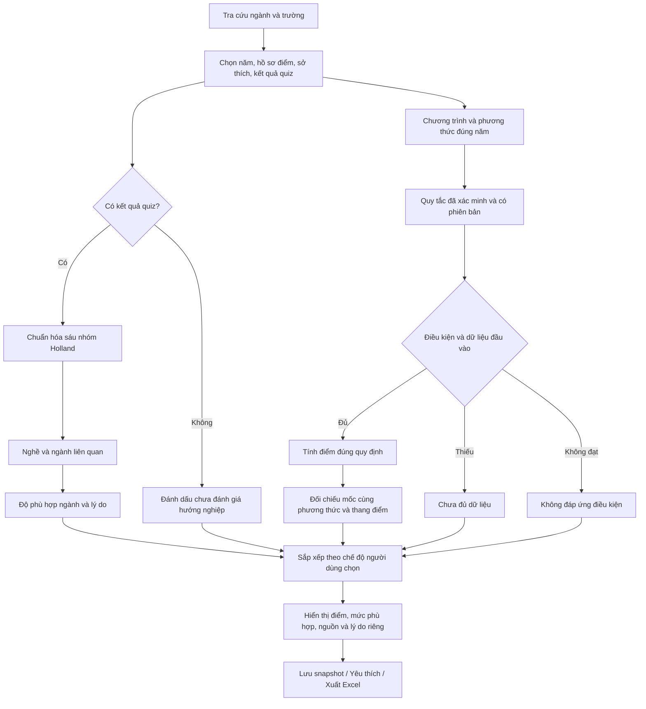

Quy trình tính:

1. **Chọn ứng viên:** Theo năm, khu vực, học phí và chương trình công khai; quiz không tự loại toàn bộ ngành khác.
2. **Kiểm tra điều kiện:** Đủ điều kiện, không đủ hoặc chưa đủ thông tin. Kết quả không đủ điều kiện được hiển thị riêng, không đứng trên lựa chọn đáp ứng chỉ vì hợp sở thích.
3. **Tính điểm:** Theo phương thức, môn/hệ số, quy đổi chứng chỉ, ưu tiên, giới hạn và bước làm tròn của chương trình/năm.
4. **Đối chiếu:** Chỉ so mốc tương thích. So với năm trước phải ghi năm; đổi thang/phương thức thì đánh dấu không so sánh trực tiếp được.
5. **Tính phù hợp:** Dùng toàn bộ sáu nhóm Holland và hồ sơ ngành, không chỉ ba chữ cái đầu.
6. **Xếp hạng:** Áp dụng chế độ và ưu tiên người dùng. Lưu phiên bản thuật toán và giải thích.

**Chuẩn hóa đề xuất:** `100 × (điểm thô − điểm tối thiểu) / (điểm tối đa − điểm tối thiểu)` cho từng nhóm, sau khi xử lý câu đảo chiều và trọng số. Bộ chấm phải xác nhận mẫu số dương. Có thể dùng cosine similarity của hai vector không âm để xếp hạng độ phù hợp; vector bằng 0 trả “chưa đánh giá”, không chia cho 0. Giá trị tương đồng chỉ là chỉ số xếp hạng, không phải phép đo tâm lý đã được kiểm định.

Hồ sơ Holland của nghề/ngành và quan hệ nghề–ngành phải được chuyên môn rà soát. Đa trí tuệ ban đầu dùng để bổ sung diễn giải/lộ trình, không loại ngành hay kết luận năng lực học tập. Khi các nhóm gần bằng nhau, hiển thị nhiều khả năng; không khẳng định một nghề duy nhất.

| Chế độ | Hành vi |
|---|---|
| Theo điểm | Phân nhóm điều kiện, đối chiếu điểm và sắp xếp trong các mốc tương thích |
| Theo hướng nghiệp | Ưu tiên mức phù hợp ngành, vẫn hiển thị rõ điều kiện xét tuyển |
| Kết hợp | Điều kiện → nhóm đối chiếu điểm → độ phù hợp → ưu tiên địa điểm/học phí |
| Tất cả | Mở rộng khám phá, không áp bộ lọc Holland ngầm |

Không trộn chênh lệch 1 điểm thang 30 với 1 điểm HSA/TSA để xếp hạng trực tiếp. Nếu dùng điểm tổng hợp sau này, phải chuẩn hóa và kiểm định riêng, công bố trọng số. Phiên bản đầu ưu tiên thứ tự nhiều tiêu chí có giải thích.

Thiếu điểm vẫn xem được ngành hợp sở thích; thiếu quiz vẫn tra cứu điểm; thiếu nguồn/mốc thì không kết luận cơ hội. Người dùng chọn kết quả quiz đang áp dụng và có thể tắt cá nhân hóa.

### 5.5. Nhập Excel có kiểm tra

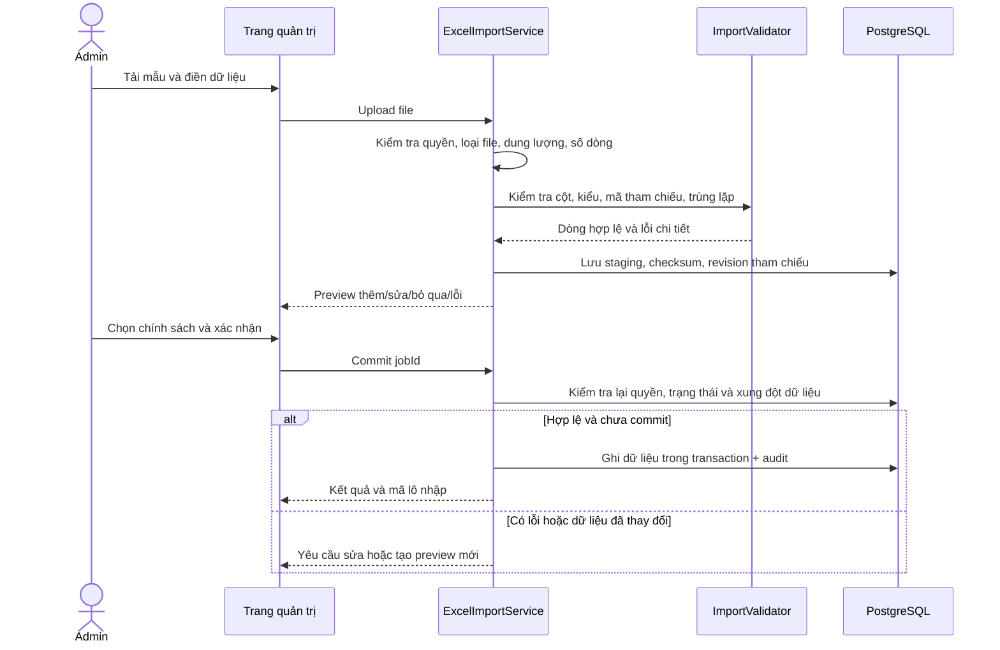

Mặc định không nhập một phần âm thầm. Lô nhỏ dùng một transaction; lô lớn chia batch với trạng thái/khôi phục được đặc tả trước. Commit lặp không tạo trùng. Có lựa chọn thêm mới/cập nhật rõ ràng, khóa nhận diện ổn định và không tự xuất bản sau nhập.

### 5.6. Xuất Excel

- Học sinh: tổng quan, quiz/phiên bản, hồ sơ điểm, đề xuất, lý do và yêu thích của mình.
- Admin: danh mục, điểm chuẩn, quiz, thống kê tổng hợp; dữ liệu cá nhân cần quyền riêng.
- Bộ lọc: năm, trường, ngành, phương thức, khoảng thời gian, trạng thái xác minh.
- File ghi thời điểm xuất, năm tuyển sinh, thang điểm, nguồn và phiên bản cần thiết.
- Xuất theo snapshot để các sheet nhất quán; không đưa token, secret hay hash phiên vào file.
- Ghi ô văn bản dưới dạng văn bản, xử lý dữ liệu bắt đầu bằng `=`, `+`, `-`, `@` để tránh bị hiểu thành công thức.
- File tải về có thời hạn; kiểm tra quyền và chủ sở hữu job trước khi cấp link tải. Thu hồi quyền áp dụng cho lần cấp link tiếp theo; URL đã ký có TTL ngắn.
- Nhập Excel không thực thi macro/công thức và không tự tải liên kết bên ngoài; dữ liệu công thức ở cột nghiệp vụ phải bị từ chối hoặc yêu cầu chuyển thành giá trị.

Vòng đời job: `UPLOADED → VALIDATED → COMMITTED` hoặc `FAILED/CANCELLED/EXPIRED` với import; `PENDING → PROCESSING → READY → EXPIRED` hoặc `FAILED` với export. Excel là định dạng trao đổi, không thay bản sao lưu database.

## 6. Bản đồ giao diện và trải nghiệm

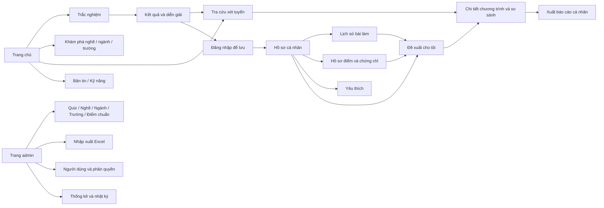

Đường dẫn bổ sung dự kiến: `/nghe-nghiep`, `/nganh-hoc`, `/truong`, `/ho-so`, `/ket-qua`, `/de-xuat`, `/admin/*`. Giữ các đường dẫn công khai hiện tại; nếu đổi URL phải có chuyển hướng. Mỗi trang cần trạng thái tải, rỗng, lỗi và chưa đủ dữ liệu, hỗ trợ điện thoại và bàn phím.

<a id="upgrade-api"></a>

## 7. Hợp đồng API dự kiến

| Phương thức | Đường dẫn | Chức năng / Quyền |
|---|---|---|
| GET | `/oauth2/authorization/google` | Spring Security bắt đầu OAuth2 Login bằng chuyển hướng trình duyệt |
| GET | `/login/oauth2/code/google` | Callback do Spring Security xử lý; kiểm tra state, đổi code, xác minh OIDC |
| GET | `/api/auth/csrf` | Cấp/làm mới CSRF token theo cấu hình SPA, không trả secret phiên |
| POST | `/api/logout` | Spring Security logout, kiểm tra CSRF và thu hồi phiên; khớp frontend hiện tại |
| GET | `/api/users/me` | Giữ tương thích với frontend hiện tại |
| PATCH | `/api/users/me` | Sửa các trường hồ sơ được phép, không nhận role |
| GET | `/api/quizzes` | Danh sách quiz công khai |
| POST | `/api/quiz-attempts` | Bắt đầu bài, cố định phiên bản |
| PUT | `/api/quiz-attempts/:id/answers` | Lưu đáp án, kiểm tra chủ sở hữu |
| POST | `/api/quiz-attempts/:id/submit` | Nộp bài idempotent |
| POST | `/api/quiz-attempts/:id/claim` | Nhận bài tạm vào tài khoản sau xác minh |
| GET | `/api/me/quiz-results` | Lịch sử cá nhân |
| GET/POST | `/api/me/score-profiles` | Đọc/tạo hồ sơ điểm cá nhân |
| PATCH | `/api/me/score-profiles/:id` | Sửa với revision chống ghi đè |
| GET | `/api/careers`, `/api/majors`, `/api/universities` | Danh mục công khai, phân trang |
| GET | `/api/programs/:id` | Chi tiết chương trình, nguồn và điểm |
| POST | `/api/admissions/search` | Tra cứu không bắt buộc quiz |
| POST | `/api/recommendations` | Cá nhân hóa, kiểm tra quyền dữ liệu đầu vào |
| GET/POST/DELETE | `/api/me/bookmarks[/:id]` | Yêu thích cá nhân |
| POST | `/api/me/exports` | Tạo báo cáo của mình |
| GET | `/api/me/exports/:id/download` | Kiểm tra quyền rồi cấp file |
| GET/POST/PATCH | `/api/admin/quizzes`, `/api/admin/quiz-versions/:id` | Quản trị quiz |
| POST | `/api/admin/quiz-versions/:id/publish` | Kiểm tra và xuất bản |
| GET/POST/PATCH | `/api/admin/careers`, `/api/admin/majors`, `/api/admin/programs` | Quản trị danh mục |
| GET/POST/PATCH | `/api/admin/admission-rules`, `/api/admin/benchmarks` | Quản trị tuyển sinh |
| POST | `/api/admin/imports`, `/api/admin/imports/:id/commit` | Preview và commit Excel |
| POST | `/api/admin/exports` | Xuất theo phạm vi được cấp |
| GET | `/api/admin/audit-logs` | Nhật ký theo quyền |
| PATCH | `/api/admin/users/:id/roles` | Cấp/thu hồi quyền, ghi audit |

Quy ước: DTO có validation, giới hạn trang/dòng/file, mã lỗi ổn định, request ID; dùng 401 cho chưa đăng nhập, 403 cho thiếu quyền, 404 khi không được biết đối tượng, 409 cho xung đột phiên bản và 422 cho dữ liệu nghiệp vụ sai. Lỗi không trả stack trace/secret. Tài liệu OpenAPI là hợp đồng chi tiết khi triển khai.

## 8. Bảo mật, dữ liệu và triển khai

### 8.1. Kiểm soát bắt buộc

- Kiểm tra quyền ở backend trên mọi endpoint, không chỉ ẩn nút admin.
- Kiểm tra quyền sở hữu mọi attempt, hồ sơ điểm, bookmark, lượt đề xuất và file xuất.
- Kiểm tra trạng thái tài khoản/phiên; không chỉ dựa vào role cũ trong dữ liệu trình duyệt.
- Giới hạn tần suất đăng nhập, tạo bài, nộp bài và nhập/xuất.
- Chống CSRF, kiểm tra Origin, CORS theo danh sách cho phép; làm sạch rich text và kiểm tra file.
- Audit đổi quyền, xuất dữ liệu cá nhân, xuất bản quiz, sửa quy tắc/điểm chuẩn và commit import.
- Nhật ký không lưu token, mật khẩu, ID token Google hoặc hồ sơ cá nhân đầy đủ không cần thiết.
- Chỉ thu thập dữ liệu cần cho hướng nghiệp; thông báo mục đích và chính sách lưu giữ/xóa tài khoản trước vận hành.
- Quản trị không mặc định xem mọi hồ sơ học sinh; tách quyền hỗ trợ, thống kê và xuất dữ liệu cá nhân.

### 8.2. Sơ đồ triển khai

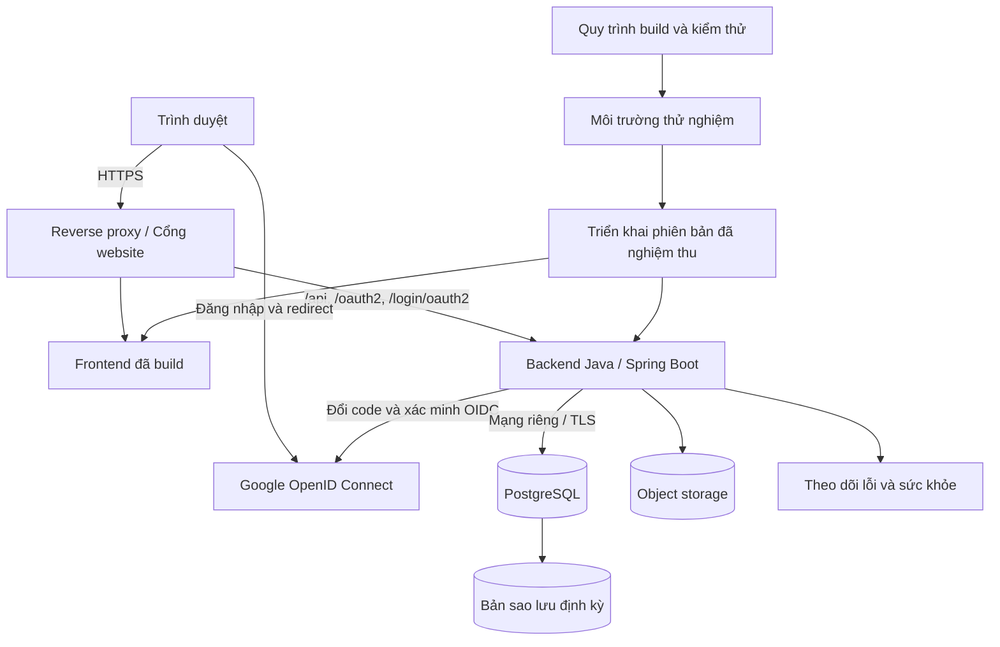

Ưu tiên frontend và API cùng origin để đơn giản cookie. Cấu hình Google client ID, client secret và callback URL chính xác cho từng môi trường. Proxy hiện tại đã có `/api` và `/oauth2`; khi triển khai cần thêm `/login/oauth2` ở Vite/reverse proxy, tránh để callback bị frontend xử lý. Với proxy TLS, cấu hình forwarded headers từ proxy đáng tin cậy để backend dựng đúng URL HTTPS. Phiên bản đầu dùng một backend; chỉ thêm hàng đợi/worker khi tác vụ lớn yêu cầu.

### 8.3. Cấu hình và vận hành

| Biến cấu hình dự kiến | Nơi dùng | Ghi chú |
|---|---|---|
| `SPRING_DATASOURCE_URL` | Backend | JDBC URL PostgreSQL, không commit cấu hình thật |
| `SPRING_DATASOURCE_USERNAME`, `SPRING_DATASOURCE_PASSWORD` | Backend | Thông tin kết nối bí mật |
| `GOOGLE_CLIENT_ID`, `GOOGLE_CLIENT_SECRET` | Backend | Ánh xạ vào cấu hình OAuth2 registration, secret không đưa ra frontend |
| `APP_ORIGIN` | Backend | Origin cho cookie/CSRF/CORS |
| `STORAGE_*` | Backend | Bucket, endpoint và thông tin truy cập |
| `FRONTEND_PORT`, `APP_PORT` | Dev | Giữ tương thích cấu hình proxy hiện có |

Đây là danh sách dự kiến; chưa có backend để chạy bằng các biến này. Không đưa secret vào biến frontend có tiền tố công khai. Chuẩn hóa một package manager/lockfile cho mỗi workspace trong giai đoạn nền tảng.

Backend dùng Maven Wrapper, JDK LTS tương thích phiên bản Spring Boot được chọn khi khởi tạo và build executable JAR. Frontend tiếp tục dùng Node/TypeScript, không chuyển sang Java. Flyway là nguồn quản lý schema duy nhất; production đặt Hibernate `ddl-auto=validate`, không dùng `update/create` để thay migration. Dữ liệu mẫu chỉ nạp ở profile dev/test; dữ liệu production nhập qua quy trình quản trị. Bổ sung Spring Boot Actuator cho kiểm tra sức khỏe và giới hạn quyền các endpoint vận hành.

Sao lưu database tự động, lưu ngoài máy chạy ứng dụng, có thời hạn giữ và thử khôi phục định kỳ. Xác định mục tiêu mất dữ liệu cho phép và thời gian phục hồi trước khi vận hành. Khi triển khai: sao lưu → migration tương thích → backend/frontend → kiểm tra nhanh; có kế hoạch quay lại và xử lý migration không thể đảo ngược.

<a id="upgrade-roadmap"></a>

## 9. Lộ trình thực hiện và sản phẩm bàn giao

Các mục dưới đây là backlog kiến trúc đích. Tiến độ khung được theo dõi riêng tại [IMPLEMENTATION.md](docs/IMPLEMENTATION.md); chưa đánh dấu hoàn thành cả giai đoạn khi vẫn còn hạng mục cần làm. Nhập/xuất Excel chưa thuộc đợt triển khai hiện tại.

### Giai đoạn 1 — Nền tảng và dữ liệu

- [ ] Rà soát build/lint, thống nhất package manager và các cấu hình môi trường.
- [ ] Chốt thuật ngữ nghề/ngành/chương trình, mã định danh và năm/đợt tuyển sinh.
- [ ] Tạo backend Java/Spring Boot theo package nghiệp vụ, Maven Wrapper, PostgreSQL, Flyway và dữ liệu khởi tạo.
- [ ] Thiết lập validation, lỗi, request ID, giao dịch và OpenAPI.
- [ ] Rà soát, nhập dữ liệu hiện có; chưa xác minh thì không công bố là dữ liệu chính thức.
- [ ] Chuyển danh mục công khai từ file sang API.

**Bàn giao:** Frontend đọc danh mục từ database, khởi tạo lại môi trường được từ tài liệu.

### Giai đoạn 2 — Danh tính và hồ sơ

- [ ] Spring Security OAuth2 Login Google, callback, xác minh OIDC, Spring Session JDBC, logout và thu hồi phiên.
- [ ] Quyền học sinh/admin, cấp admin ban đầu và kiểm tra sở hữu.
- [ ] Hồ sơ cá nhân, hồ sơ điểm có revision, chứng chỉ và tùy chọn.
- [ ] Bookmark database và hợp nhất bookmark khách không trùng.
- [ ] Chính sách lưu dữ liệu, khóa/xóa tài khoản và giới hạn truy cập.

**Bàn giao:** Đăng nhập thật, mở lại đúng hồ sơ và dữ liệu trên thiết bị khác.

### Giai đoạn 3 — Quiz động và trang quản trị

- [ ] CRUD, xem trước, xuất bản và lưu trữ phiên bản quiz.
- [ ] Chấm Holland/MI bằng strategy, chuẩn hóa và kiểm tra câu trả lời.
- [ ] Lưu tiến độ, nộp idempotent, lịch sử và nhận bài khách vào tài khoản.
- [ ] Admin quản lý nghề/ngành, hồ sơ Holland và các quan hệ.
- [ ] Nhật ký, chống ghi đè thay đổi đồng thời và kiểm tra nội dung trước xuất bản.

**Bàn giao:** Admin cập nhật được quiz/ngành không sửa mã; bài cũ vẫn đúng phiên bản.

### Giai đoạn 4 — Tuyển sinh và đề xuất liên thông

- [ ] Trường, cơ sở, chương trình, năm/đợt, phương thức và nguồn.
- [ ] Quy tắc có phiên bản: môn/hệ số/quy đổi/ưu tiên/làm tròn.
- [ ] Điểm chuẩn và ngưỡng hồ sơ tách biệt, thiếu dữ liệu không gán 0.
- [ ] Liên kết quiz → nghề → ngành → chương trình.
- [ ] Chế độ theo điểm/hướng nghiệp/kết hợp/tất cả, lý do và nguồn đối chiếu.
- [ ] Snapshot lượt đề xuất, so sánh, chọn kết quả quiz áp dụng.

**Bàn giao:** Quiz thay đổi được gợi ý; điểm xét tuyển vẫn đúng quy định và độc lập với quiz.

### Giai đoạn 5 — Excel, nội dung và vận hành

- [ ] Apache POI: mẫu, upload, kiểm tra, preview, commit và báo cáo lỗi nhập Excel.
- [ ] Xuất dữ liệu cá nhân/admin theo quyền, chống công thức nguy hiểm.
- [ ] Bản tin, kỹ năng và tài nguyên có nguồn/ngày cập nhật.
- [ ] Giao diện điện thoại, bàn phím và trạng thái tải/rỗng/lỗi.
- [ ] Kiểm thử tích hợp, luồng cuối, tải và an toàn truy cập.
- [ ] Staging, HTTPS, theo dõi lỗi, sao lưu và diễn tập khôi phục.
- [ ] Hướng dẫn quản trị, cập nhật dữ liệu và triển khai chính thức.

**Bàn giao:** Website vận hành được, quản trị viên cập nhật/xuất dữ liệu và phục hồi được khi có sự cố.

### 9.1. Thứ tự phụ thuộc

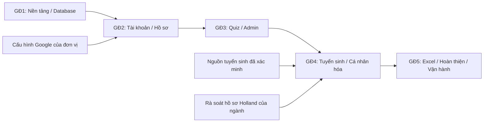

### 9.2. Tiêu chí nghiệm thu và kiểm thử

| Nhóm | Tình huống bắt buộc | Kết quả |
|---|---|---|
| Đăng nhập | Callback sai state, code không hợp lệ, ID token hết hạn/sai audience | Bị từ chối, không tạo phiên xác thực |
| Phiên | Logout hoặc khóa tài khoản | Phiên không tiếp tục truy cập được |
| Phân quyền | Học sinh gọi API admin, đổi role trong request | Bị từ chối |
| Sở hữu | Đoán ID hồ sơ/bài làm/export của người khác | Không đọc/sửa/tải được |
| Quiz | Nộp thiếu câu, option sai phiên bản | Có lỗi rõ ràng, không tính ngầm |
| Quiz | Nhấn nộp nhiều lần hoặc đồng thời | Chỉ một kết quả cuối |
| Phiên bản | Admin sửa quiz sau khi có bài làm | Tạo phiên bản mới, lịch sử giữ nguyên |
| Xét tuyển | Mẫu điểm theo nguồn: chứng chỉ, hệ số, ưu tiên, giới hạn | Khớp kết quả tính thủ công đã duyệt |
| Thang điểm | HSA/TSA/THPT khác thang, mốc không tương thích | Không so chênh lệch trực tiếp |
| Cá nhân hóa | Hai học sinh cùng điểm, khác Holland | Điểm xét tuyển bằng nhau; đề xuất có thể khác |
| Dữ liệu thiếu | Thiếu quiz/điểm/nguồn hoặc vector 0 | Không lỗi, ghi chưa đủ dữ liệu |
| Snapshot | Sửa hồ sơ điểm/ngành/quy tắc sau khi xuất | Báo cáo cũ vẫn tái hiện được đầu vào/lý do |
| Excel import | Trùng mã, sai cột, commit lại, dữ liệu đổi sau preview | Báo lỗi hoặc chặn xung đột, không tạo trùng |
| Excel export | Giả mạo job, ô có công thức, quyền vừa bị thu hồi | Bảo vệ đúng dữ liệu và lần cấp file |
| Khôi phục | Phục hồi vào môi trường sạch | Đọc được dữ liệu và chạy được luồng chính |

Unit test Java dùng JUnit và Mockito, tập trung vào luật chấm/tính/xếp hạng; integration test dùng Spring Boot Test, Spring Security Test và PostgreSQL qua Testcontainers cho giao dịch, quyền và repository; không thay PostgreSQL bằng SQLite/H2 khi kiểm tra truy vấn, khóa và migration. Test OAuth2 dùng môi trường/nhà cung cấp giả lập có kiểm soát và kiểm tra Google thật trên staging. End-to-end kiểm tra đăng nhập → quiz → nhập điểm → đề xuất → xuất báo cáo. Không chỉ kiểm tra giao diện hoặc mock toàn bộ nghiệp vụ.

## 10. Tài liệu và các quyết định cần chốt khi triển khai

Các quyết định triển khai đã chốt: giữ frontend React/TypeScript hiện tại; backend Java + Spring Boot; PostgreSQL; Spring Data JPA/Hibernate và Flyway; Spring Security OAuth2 Login Google, Spring Session JDBC; Apache POI cho Excel. Vai trò theo tập quyền; quiz có phiên bản; điểm và độ phù hợp hiển thị riêng; đối chiếu có nguồn thay cho phần trăm đỗ chưa kiểm định. Không dùng SQLite cho database của kế hoạch này.

Trước khi đưa lên chính thức cần chốt: đơn vị sở hữu tài khoản Google và hosting, danh sách trường/năm ưu tiên, người xác minh dữ liệu, bộ mẫu tính điểm chuẩn, người duyệt hồ sơ Holland ngành, phạm vi dữ liệu cá nhân được xuất và chính sách lưu giữ. Chưa ấn định chi phí hoặc lịch hoàn thành khi chưa xác định lượng dữ liệu và nguồn lực triển khai.

Nguồn kỹ thuật tham khảo:

- [Google: xác minh ID token phía server](https://developers.google.com/identity/gsi/web/guides/verify-google-id-token).
- [Google: cấu hình client ID](https://developers.google.com/identity/gsi/web/guides/get-google-api-clientid).
- [Spring Security: OAuth2 Login và OpenID Connect](https://docs.spring.io/spring-security/reference/servlet/oauth2/login/index.html).
- [Spring Security: cấu hình OAuth2 Login](https://docs.spring.io/spring-security/reference/servlet/oauth2/login/core.html).
- [Spring Boot: SQL, Spring Data JPA và Hibernate](https://docs.spring.io/spring-boot/reference/data/sql.html).
- [Spring Boot: khởi tạo database và Flyway](https://docs.spring.io/spring-boot/how-to/data-initialization.html).
- [Apache POI: xử lý bảng tính Excel](https://poi.apache.org/components/spreadsheet/).
- [OWASP: kiểm soát quyền truy cập](https://cheatsheetseries.owasp.org/cheatsheets/Authorization_Cheat_Sheet.html).
- [PostgreSQL: sao lưu và khôi phục](https://www.postgresql.org/docs/current/backup.html).
