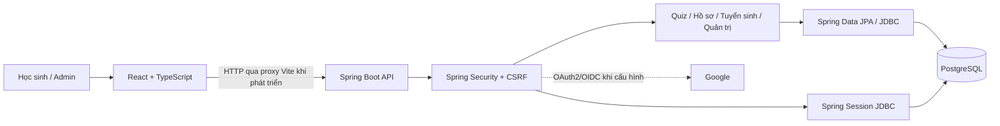
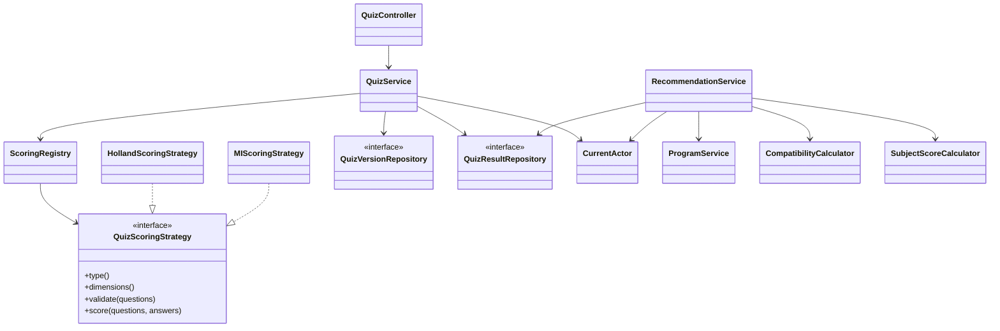
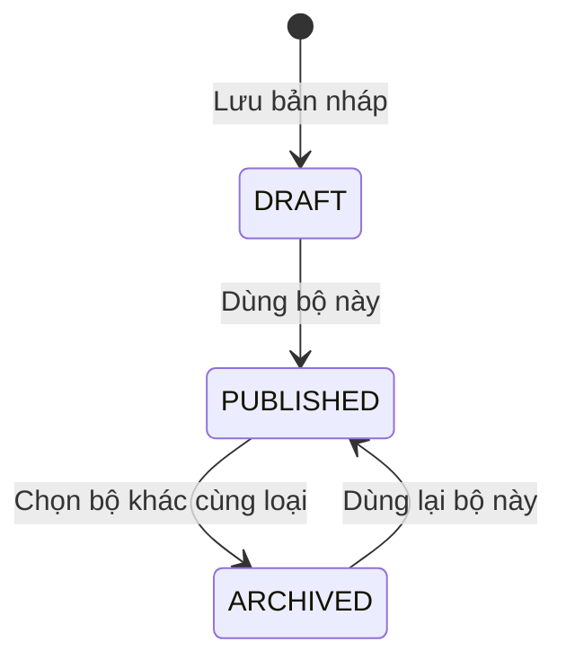
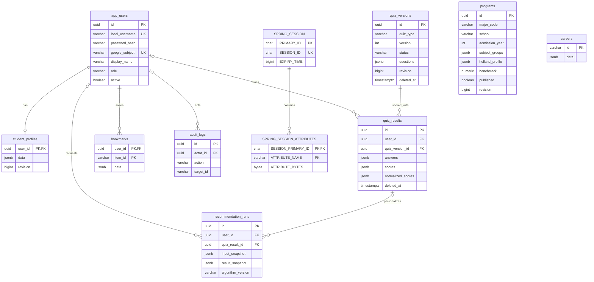
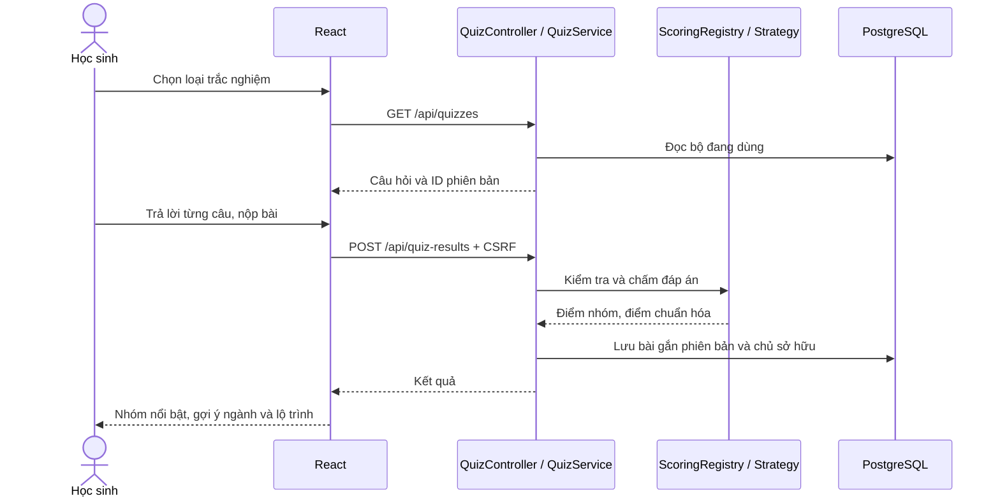
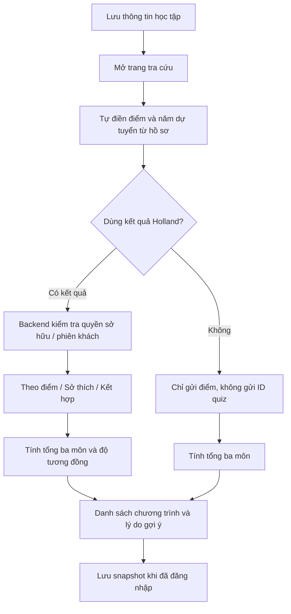
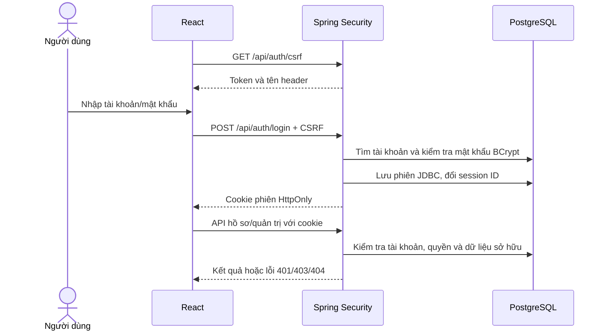

# Hướng nghiệp — THPT Chuyên Biên Hòa

Website giúp học sinh khám phá sở thích, tìm hiểu ngành học và xây dựng lộ trình kỹ năng. Dự án sử dụng **React + TypeScript** cho giao diện, **Java 21 + Spring Boot** cho backend và **PostgreSQL** để lưu dữ liệu.

**Cập nhật: 20/10/2026.** Đã có luồng tài khoản, trắc nghiệm có phiên bản, lịch sử, hồ sơ học tập, tra cứu kết hợp Holland và quản trị nội dung. Đây là bản phát triển; dữ liệu tuyển sinh mẫu chưa được xác minh. Nhập/xuất Excel được dành cho đợt sau.

## Mục lục

- [Chức năng hiện có](#chức-năng-hiện-có)
- [Chạy chương trình](#chạy-chương-trình)
- [Sử dụng website](#sử-dụng-website)
- [Công nghệ và cấu trúc thư mục](#công-nghệ-và-cấu-trúc-thư-mục)
- [Kiến trúc và cấu trúc OOP](#kiến-trúc-và-cấu-trúc-oop)
- [Database và sơ đồ dữ liệu](#database-và-sơ-đồ-dữ-liệu)
- [Luồng nghiệp vụ](#luồng-nghiệp-vụ)
- [API chính](#api-chính)
- [Kiểm thử và đóng gói](#kiểm-thử-và-đóng-gói)
- [Lỗi thường gặp](#lỗi-thường-gặp)
- [Giới hạn và kế hoạch tiếp theo](#giới-hạn-và-kế-hoạch-tiếp-theo)

## Chức năng hiện có

| Phần | Chức năng |
|---|---|
| Tài khoản | Đăng ký, đăng nhập bằng tài khoản/mật khẩu; phân quyền học sinh và admin |
| Google | Có luồng OAuth2/OIDC, chỉ hiện nút khi đã cấu hình Client ID/Secret |
| Trắc nghiệm | Holland RIASEC và Đa trí tuệ; mỗi màn hình một câu; tiến độ; chọn bằng chuột hoặc phím 1–5 |
| Kết quả | Bố cục bento: nhóm nổi bật, điểm từng nhóm, gợi ý ngành/hướng học và lộ trình kỹ năng |
| Lịch sử | Xem lại chi tiết, dùng bài Holland để tra cứu, xóa và hoàn tác kết quả của mình |
| Hồ sơ học tập | Lưu trường, lớp, năm dự tuyển và điểm môn học; tự điền điểm/năm khi mở tra cứu |
| Tra cứu | Tính tổng ba môn; tùy chọn kết hợp kết quả Holland; chọn cách sắp xếp gợi ý |
| Yêu thích | Lưu nghề/chương trình; tài khoản đăng nhập đồng bộ với backend, khách dùng dữ liệu cục bộ |
| Quản lý quiz | Tạo bản nháp từ mẫu hoặc khung đủ nhóm; chọn bộ đang dùng, chọn lại bộ cũ, xóa/hoàn tác |
| Quản lý tuyển sinh | Thêm/sửa chương trình tại trường, tổ hợp môn, hồ sơ Holland, mốc tham khảo, nguồn và trạng thái công khai |
| Nội dung tham khảo | Bản tin, liên kết tuyển sinh và bản đồ kỹ năng từ dữ liệu có sẵn trong frontend |

Giao diện dùng nền sáng, nhiều khoảng trắng, xanh ngọc/cam, hỗ trợ điện thoại, thao tác bàn phím và tùy chọn giảm chuyển động của hệ điều hành.

**Phân biệt dữ liệu mẫu và dữ liệu đang dùng:** bộ seed ban đầu có 24 câu Holland, 40 câu Đa trí tuệ, 23 nghề và 14 chương trình. Sau khi admin tạo/chọn phiên bản khác, số câu thực tế được lấy từ bộ đang sử dụng, không cố định ở các con số này. Bản tin và tài nguyên kỹ năng chưa có giao diện quản trị riêng.

## Chạy chương trình

### 1. Yêu cầu

| Công cụ | Yêu cầu của project |
|---|---|
| Node.js | Vite hiện tại yêu cầu `^20.19.0` hoặc `>=22.12.0` |
| npm | Dùng cùng Node.js; frontend có `package-lock.json` |
| Java | JDK 21, khai báo `JAVA_HOME` hoặc có `java` trong PATH |
| PostgreSQL | Máy phát triển đã kiểm tra với PostgreSQL 18; mặc định cổng `5432` |
| Maven | Có Maven Wrapper trong `backend/`, không bắt buộc cài riêng |

Lần cài dependency đầu tiên cần kết nối mạng. Docker là lựa chọn bổ sung, không bắt buộc.

### 2. Nếu máy hiện tại đã được cấu hình

Mở **hai cửa sổ PowerShell** tại thư mục project. Bảo đảm dịch vụ PostgreSQL đang chạy.

Cửa sổ thứ nhất — chạy backend:

```powershell
cd D:\HungCao\webhuongnghiep
.\scripts\backend.ps1 -Task run
```

Chờ xuất hiện `Started CareerGuidanceApplication` và cổng `8080`.

Cửa sổ thứ hai — chạy giao diện:

```powershell
cd D:\HungCao\webhuongnghiep\frontend
npm run dev
```

Mở **http://localhost:5173**. Giữ cả hai cửa sổ Terminal mở; nhấn `Ctrl + C` trong từng cửa sổ để dừng. Chỉ chạy `npm run dev` sẽ chưa đủ cho tài khoản, quiz và database thật.

### 3. Cài đặt trên máy mới

Các lệnh sau chạy từ thư mục gốc repository. Chỉ sao chép file mẫu khi chưa có cấu hình riêng, tránh ghi đè thông tin kết nối đã thiết lập.

**Cài thư viện frontend:**

```powershell
npm ci --prefix frontend
Copy-Item frontend/.env.example frontend/.env.local
```

Trong `frontend/.env.local`, đặt:

```dotenv
VITE_USE_BACKEND=true
FRONTEND_PORT=5173
APP_PORT=8080
```

**Tạo database:** đăng nhập PostgreSQL bằng tài khoản có quyền tạo role/database rồi chạy SQL dưới đây. Thay mật khẩu ví dụ bằng mật khẩu riêng của bạn.

```sql
CREATE ROLE huongnghiep LOGIN PASSWORD 'replace-with-your-own-password';
CREATE DATABASE huongnghiep OWNER huongnghiep;
```

**Cấu hình backend:**

```powershell
Copy-Item backend/.env.example backend/.env
```

Chỉnh các giá trị trong `backend/.env`:

```dotenv
SPRING_DATASOURCE_URL=jdbc:postgresql://localhost:5432/huongnghiep
SPRING_DATASOURCE_USERNAME=huongnghiep
SPRING_DATASOURCE_PASSWORD=replace-with-your-own-password
APP_ORIGIN=http://localhost:5173
SEED_ENABLED=true
COOKIE_SECURE=false
LOCAL_ADMIN_ENABLED=false
```

Mật khẩu phải trùng với role PostgreSQL vừa tạo. `SEED_ENABLED=true` nạp dữ liệu phát triển vào các danh mục tương ứng khi chúng còn rỗng; không dùng seed làm nguồn tuyển sinh chính thức.

Sau đó chạy backend và frontend như bước 2. Flyway tự áp dụng migration khi backend khởi động. Không cần tạo từng bảng thủ công.

**Lưu ý về `.env`:** Spring Boot không tự đọc file này; script `scripts/backend.ps1` đọc và truyền thành biến môi trường. Nếu chạy Java bằng IDE hoặc chạy file JAR trực tiếp, phải khai báo các biến trong môi trường/run configuration. Không commit `.env`, mật khẩu hay Google Client Secret.

### 4. Tạo admin lần đầu

Trên môi trường mới, đặt trong `backend/.env` trước khi khởi động backend:

```dotenv
LOCAL_ADMIN_ENABLED=true
LOCAL_ADMIN_USERNAME=admin
LOCAL_ADMIN_PASSWORD=replace-with-a-strong-password
```

Sau khi tài khoản được tạo, đặt lại `LOCAL_ADMIN_ENABLED=false`. Đăng nhập tại `/login`, rồi mở `/admin`. Bootstrap chỉ tạo tài khoản chưa tồn tại; không đổi mật khẩu hay nâng quyền tài khoản có sẵn. Không có mật khẩu admin mặc định trong source code.

Máy phát triển hiện tại đã có cấu hình kết nối và tài khoản admin riêng; không cần tạo lại database hoặc bật lại bootstrap để sử dụng.

### 5. Đăng nhập Google — tùy chọn

Điền `GOOGLE_CLIENT_ID` và `GOOGLE_CLIENT_SECRET` trong cấu hình backend. Đăng ký callback phát triển chính xác:

```text
http://localhost:5173/login/oauth2/code/google
```

Khởi động lại backend sau khi sửa cấu hình. Nếu chưa cấu hình Google, đăng nhập tài khoản/mật khẩu vẫn hoạt động. Luồng Google đã có mã nhưng chưa được kiểm tra đăng nhập thật bằng OAuth client của đơn vị.

### 6. Chế độ demo không cần database

Đặt `VITE_USE_BACKEND=false` trong `frontend/.env.local`, rồi khởi động lại frontend. Chế độ này dùng giao diện/dữ liệu demo cũ; không đại diện cho đầy đủ luồng tài khoản, quản trị, lịch sử và giao diện quiz kết nối backend mới.

Để sử dụng các chức năng mô tả trong README này, chọn **`VITE_USE_BACKEND=true`**.

## Sử dụng website

### Các trang chính

| Đường dẫn | Nội dung | Quyền |
|---|---|---|
| `/` | Trang chủ | Công khai |
| `/trac-nghiem` | Chọn Holland hoặc Đa trí tuệ và làm bài | Công khai |
| `/xet-tuyen` | Nhập điểm, chọn kết quả Holland và tra cứu | Công khai |
| `/ky-nang` | Lộ trình và tài nguyên kỹ năng | Công khai |
| `/ban-tin` | Nội dung hướng nghiệp tham khảo | Công khai |
| `/yeu-thich` | Danh sách đã lưu | Khách/tài khoản |
| `/login` | Đăng nhập và tạo tài khoản | Khách |
| `/dashboard` | Hồ sơ học tập và lịch sử trắc nghiệm | Đã đăng nhập |
| `/dashboard/results/:id` | Xem lại kết quả của mình | Chủ tài khoản |
| `/admin` | Quản lý quiz, ngành và trường | Admin |

### Hồ sơ, lịch sử và điểm học tập

1. Đăng nhập và mở **Hồ sơ**.
2. Nhập thông tin học tập, điểm môn học, năm dự tuyển rồi bấm **Lưu hồ sơ**.
3. Mở **Tìm ngành & trường**: website tự điền điểm và năm đã lưu. Có thể sửa cho lần tra cứu hiện tại; việc sửa ở đây không tự ghi đè hồ sơ.
4. Trong lịch sử, bấm tên bài hoặc **Xem kết quả** để mở lại chi tiết. Bài Holland có thêm **Dùng kết quả này để tra cứu**.
5. **Xóa kết quả** ẩn bài khỏi lịch sử và ngăn dùng bài đó để tra cứu; có nút **Hoàn tác** ngay trên trang sau khi xóa.

Khách có thể làm bài trước khi đăng nhập; kết quả khách gần nhất theo từng loại trong phiên được nhận vào tài khoản khi mở hồ sơ. Đáp án đang làm chỉ giữ trong bộ nhớ giao diện, chưa có lưu nháp qua lần tải lại trang.

### Chọn và xóa bộ câu hỏi

Vào **Quản trị nội dung → Bộ trắc nghiệm**:

- **Dùng làm mẫu / Sao chép phiên bản:** đưa nội dung vào form để tạo bản nháp mới; không sửa bản gốc.
- **Tạo khung đủ nhóm:** tạo các ô câu hỏi để nhập nội dung. Holland cần đủ 6 nhóm; Đa trí tuệ cần đủ 8 nhóm, mỗi nhóm ít nhất một câu.
- **Lưu bản nháp:** tạo phiên bản mới, chưa đổi bộ học sinh đang làm.
- **Dùng bộ này:** chọn bản nháp hợp lệ hoặc chọn lại bản lưu trữ. Bộ trước của cùng loại tự chuyển sang lưu trữ; loại còn lại giữ nguyên.
- **Đang dùng:** đánh dấu bộ hiện hành. Mỗi loại có một bộ công khai cho học sinh chọn.
- **Xóa bộ câu hỏi:** xóa mềm bản nháp hoặc bản lưu trữ; có hoàn tác. Bộ đang dùng cần được thay thế trước khi xóa. Hệ thống luôn giữ ít nhất một bộ mỗi loại.

Bài làm cũ tham chiếu đúng phiên bản gốc. Chọn bộ khác hoặc xóa mềm bộ cũ không sửa điểm/kết quả đã lưu. Số phiên bản mới không dùng lại số của bộ đã xóa.

### Quiz ảnh hưởng đến tra cứu như thế nào?

Điểm Holland dùng để xếp thứ tự gợi ý, **không cộng vào điểm môn học**. Khi tắt **Dùng kết quả trắc nghiệm Holland**, frontend không gửi ID bài quiz và tra cứu chỉ dùng điểm.

| Chế độ | Cách sắp xếp hiện tại |
|---|---|
| Theo tổng điểm (`POINTS`) | Tổng ba môn giảm dần, chương trình chưa đủ môn nằm sau |
| Theo sở thích (`INTEREST`) | Tương đồng Holland giảm dần, sau đó tổng điểm |
| Kết hợp (`COMBINED`) | Chương trình đủ điểm đầu vào trước, sau đó tương đồng Holland và tổng điểm |

“Đủ điểm đầu vào” ở đây nghĩa là đã nhập đủ môn để tính một tổ hợp, không có nghĩa đạt điểm chuẩn. Chế độ kết hợp hiện là quy tắc sắp xếp, chưa có công thức trọng số tổng hợp.

Mỗi nhóm quiz chuẩn hóa về thang 0–100 từ đáp án 1–5 theo số câu thực tế. Độ tương đồng Holland dùng cosine similarity giữa sáu nhóm của học sinh và hồ sơ ngành. Đa trí tuệ gợi ý hướng học/kỹ năng, chưa thay cho Holland trong xếp hạng tuyển sinh.

**Phần xét tuyển hiện chỉ tính tổng ba môn thang 30 và đối chiếu mốc tham khảo.** Chưa tính ưu tiên, hệ số, IELTS, HSA/TSA, học bạ hoặc điều kiện phụ; không đưa ra xác suất đỗ hay kết luận trúng tuyển.

## Công nghệ và cấu trúc thư mục

| Thành phần | Công nghệ |
|---|---|
| Giao diện | React 19, TypeScript 6, Vite 8, Tailwind CSS 4, React Router |
| Backend | Java 21, Spring Boot 3.5, Spring Web, Bean Validation |
| Tài khoản | Spring Security, BCrypt, OAuth2/OIDC, CSRF |
| Lưu trữ | PostgreSQL, Spring Data JPA/Hibernate, JSONB |
| Phiên và migration | Spring Session JDBC, Flyway |
| Kiểm thử | JUnit, MockMvc, Spring Security Test, PostgreSQL thử nghiệm, Testcontainers tùy chọn |

```text
webhuongnghiep/
├── backend/
│   ├── src/main/java/vn/edu/huongnghiep/
│   │   ├── config/                 # Security, đăng ký scoring strategy
│   │   ├── modules/
│   │   │   ├── auth/               # Tài khoản, quyền, Google, bootstrap admin
│   │   │   ├── quizzes/            # Phiên bản, bài làm, lịch sử
│   │   │   │   └── domain/         # Chấm Holland/MI độc lập với Spring
│   │   │   ├── admissions/         # Chương trình và tổng điểm tổ hợp
│   │   │   ├── recommendations/    # Ghép Holland, xếp hạng, snapshot
│   │   │   ├── profiles/           # Hồ sơ học tập
│   │   │   └── bookmarks/          # Yêu thích theo tài khoản
│   │   ├── infrastructure/         # Seed, bootstrap, persistence
│   │   └── shared/                 # Lỗi API, audit
│   ├── src/main/resources/db/migration/
│   ├── src/test/java/              # Unit, API security, PostgreSQL
│   ├── .env.example
│   └── pom.xml
├── frontend/
│   ├── src/features/               # guidance, profile, admin kết nối API
│   ├── src/pages/                  # Trang chủ, tài khoản, nội dung và demo
│   ├── src/layouts/                # Điều hướng, bố cục, thiết kế chung
│   ├── src/services/               # Hợp đồng và hàm gọi API hướng nghiệp
│   ├── src/lib/                    # API client, CSRF, routes, quyền
│   ├── src/providers/              # Trạng thái đăng nhập
│   ├── src/mocks/                  # Dữ liệu/endpoint giả cho demo
│   └── .env.example
├── scripts/backend.ps1             # Đọc .env và chạy Maven Wrapper
├── docs/DEVELOPMENT.md             # Cấu hình, API và xử lý lỗi chi tiết
├── docs/IMPLEMENTATION.md          # Phạm vi triển khai và giới hạn
├── compose.yml                    # PostgreSQL bằng Docker, tùy chọn
└── README.md
```

## Kiến trúc và cấu trúc OOP

### Sơ đồ tổng thể



Trong môi trường phát triển, frontend chạy cổng `5173`, backend cổng `8080`, PostgreSQL cổng `5432`. Vite chuyển tiếp `/api`, `/oauth2` và `/login/oauth2`; trình duyệt dùng cùng host `localhost` để cookie hoạt động nhất quán.

### Phân chia trách nhiệm

| Lớp/thành phần | Trách nhiệm |
|---|---|
| Controller | Nhận request, validation, trả DTO |
| Service | Điều phối nghiệp vụ, giao dịch và kiểm tra quyền |
| Scoring strategy | Kiểm tra câu hỏi, chấm và chuẩn hóa theo loại quiz |
| Calculator | Tính tổng tổ hợp hoặc độ tương đồng Holland |
| Repository/entity | Đọc/ghi PostgreSQL và kiểm soát revision |
| Frontend component/hook | Hiển thị, trạng thái biểu mẫu, gọi API |

Backend sử dụng interface và đa hình cho chấm quiz; đóng gói logic tính điểm trong các lớp riêng. Repository hiện là Spring Data interface và entity persistence; một số controller hồ sơ/yêu thích còn gọi persistence trực tiếp. Đây chưa phải kiến trúc Clean Architecture với đầy đủ domain entity và repository port/adapter. Frontend dùng component/hook React, không tổ chức toàn bộ giao diện thành class OOP.

### Sơ đồ lớp chính



### Trạng thái bộ câu hỏi



`deleted_at` là dấu xóa mềm riêng, không phải trạng thái thứ tư. Bản đã xóa bị ẩn khỏi danh sách và không được chọn sử dụng, nhưng giữ dữ liệu cho lịch sử. Backend khóa các phiên bản cùng loại khi đổi bộ/xóa, kiểm tra revision để tránh ghi đè thay đổi của admin khác.

## Database và sơ đồ dữ liệu

Sơ đồ dưới đây thể hiện **schema hiện tại**, không phải mô hình mở rộng trong tương lai. Một số nội dung còn được lưu trong JSONB.



`programs` hiện chứa thông tin ngành tại trường trong cùng một bản ghi, chưa tách danh mục trường/ngành thành các bảng độc lập. `bookmarks` và `recommendation_runs` lưu snapshot; không vẽ khóa ngoại tới chương trình/nghề vì schema chưa có các quan hệ đó. Bài làm khách có `user_id` rỗng.

| Migration | Nội dung |
|---|---|
| `V1__initial_schema.sql` | Bảng nghiệp vụ, session JDBC, chỉ mục và ràng buộc ban đầu |
| `V2__local_accounts.sql` | Tài khoản/mật khẩu song song với Google |
| `V3__quiz_history_trash.sql` | Xóa mềm lịch sử bài làm |
| `V4__quiz_version_trash.sql` | Xóa mềm bộ câu hỏi |

Không sửa migration đã chạy. Thay đổi schema tiếp theo dùng migration mới, bắt đầu từ V5. Hibernate đang dùng `ddl-auto=validate`, không tự sửa schema bằng `update`.

## Luồng nghiệp vụ

### Làm bài và lưu kết quả



### Hồ sơ → tra cứu → kết quả



Nếu bật kết hợp nhưng chưa chọn được bài Holland, giao diện vẫn tra cứu theo điểm và hướng dẫn làm/chọn bài. Kết quả bị xóa không được dùng để cá nhân hóa. Thay đổi biểu mẫu hoặc công tắc sẽ xóa danh sách gợi ý cũ để tránh nhầm chế độ.

### Đăng nhập và quyền truy cập



Đăng ký công khai luôn tạo tài khoản học sinh. Mật khẩu không lưu rõ; phiên đăng nhập không lưu bằng token trong localStorage. Các request thay đổi dữ liệu cần CSRF; frontend đã tự lấy token. Giới hạn thử đăng nhập/đăng ký hiện nằm trong bộ nhớ một backend.

## API chính

| Nhóm | Endpoint |
|---|---|
| Tài khoản | `GET /api/auth/config`, `GET /api/auth/csrf`, `POST /api/auth/register`, `POST /api/auth/login`, `POST /api/logout`, `GET /api/users/me` |
| Google | `GET /oauth2/authorization/google`, callback `/login/oauth2/code/google` |
| Quiz công khai | `GET /api/quizzes`, `POST /api/quiz-results` |
| Lịch sử cá nhân | `GET /api/me/quiz-results`, `GET/DELETE /api/me/quiz-results/{id}`, `POST /api/me/quiz-results/{id}/restore`, `POST /api/me/quiz-results/claim` |
| Hồ sơ/yêu thích | `GET/PUT /api/me/profile`, `GET/POST/DELETE /api/me/bookmarks`, `DELETE /api/me/bookmarks/{id}` |
| Tra cứu | `GET /api/programs`, `GET /api/careers`, `POST /api/recommendations`, `POST /api/admissions/search` |
| Quản trị quiz | `GET/POST /api/admin/quizzes`, `POST /api/admin/quizzes/{id}/publish`, `DELETE /api/admin/quizzes/{id}?revision=...`, `POST /api/admin/quizzes/{id}/restore` |
| Quản trị chương trình | `GET/POST /api/admin/programs`, `PUT /api/admin/programs/{id}` |
| Quản trị tài khoản/audit | `GET /api/admin/users`, `PUT /api/admin/users/{id}/access`, `GET /api/admin/audit-logs` |

Endpoint `publish` phục vụ nút **Dùng bộ này**, nhận `{ "revision": ... }` và hỗ trợ cả bản nháp lẫn bản lưu trữ. API tài khoản/audit đã có, giao diện quản lý người dùng và nhật ký đầy đủ còn trong kế hoạch.

Chi tiết cấu hình và API: [docs/DEVELOPMENT.md](docs/DEVELOPMENT.md).

## Kiểm thử và đóng gói

Chạy từ thư mục gốc:

```powershell
# Kiểm thử Java thông thường; test cần database/Docker mặc định bỏ qua
.\scripts\backend.ps1 -Task test

# Đóng gói backend
.\scripts\backend.ps1 -Task package

# Kiểm tra và build giao diện
npm run lint --prefix frontend
npm run build --prefix frontend
```

Build giao diện tạo `frontend/dist/`; đóng gói backend tạo JAR trong `backend/target/`. Hiện chưa có bước tự động nhúng React vào JAR hoặc tự triển khai Azure.

Để chạy kiểm thử PostgreSQL thật, tạo **database thử nghiệm riêng**, ví dụ `huongnghiep_test`, và cung cấp biến môi trường:

```powershell
$env:LOCAL_POSTGRES_TEST='true'
$env:TEST_DATABASE_URL='jdbc:postgresql://localhost:5432/huongnghiep_test'
$env:TEST_DATABASE_USERNAME='huongnghiep'
$env:TEST_DATABASE_PASSWORD='replace-with-your-test-password'
.\scripts\backend.ps1 -Task test
```

Không trỏ kiểm thử vào database đang sử dụng. Migration/seed có thể chạy trên database thử nghiệm; dữ liệu nghiệp vụ của các test PostgreSQL được rollback. Có test Testcontainers tùy chọn nếu Docker khả dụng.

**Lần kiểm tra gần nhất:** 27 test Java đã qua, gồm 14 test không cần PostgreSQL và 13 test PostgreSQL; 1 test Docker được bỏ qua. Frontend build thành công. Đã thử trên trình duyệt: làm bài, xem lại lịch sử, xóa/hoàn tác, tự điền điểm, tạo bản nháp, xóa/hoàn tác bộ câu hỏi và đổi qua lại bộ đang dùng. Đây không phải kết quả đo tải hay nghiệm thu production.

## Lỗi thường gặp

| Hiện tượng | Kiểm tra |
|---|---|
| “Chưa kết nối được máy chủ” / lỗi 502 | Backend đã chạy cổng 8080 chưa? PostgreSQL có đang chạy không? Xem lỗi trong Terminal backend |
| `password authentication failed` | Đối chiếu role, mật khẩu và URL trong `backend/.env` với PostgreSQL |
| Giao diện có nhưng tài khoản/quiz không hoạt động | Cần `VITE_USE_BACKEND=true` và chạy cả backend lẫn frontend |
| Sửa `.env` nhưng chưa có tác dụng | Khởi động lại đúng dịch vụ; Spring Boot chỉ nhận file `.env` qua script đã cung cấp |
| Không thấy nút Google | Chưa điền đủ Client ID/Secret hoặc chưa khởi động lại backend |
| Google báo sai redirect URI | Callback phải khớp host, cổng, giao thức và đường dẫn đã đăng ký |
| Không lưu được bản nháp quiz | Kiểm tra nội dung câu hỏi và đủ 6/8 nhóm; giao diện liệt kê phần còn thiếu |
| Không xóa được bộ câu hỏi | Bộ cuối cùng hoặc đang dùng; chọn bộ thay thế cùng loại trước |
| Lưu/chọn bộ báo dữ liệu đã thay đổi | Admin khác đã cập nhật revision; tải lại danh sách trước khi thao tác |
| Điểm chưa tự điền | Đăng nhập đúng tài khoản, bấm Lưu hồ sơ trước và chờ hồ sơ tải xong |
| Không dùng được ID kết quả cũ | Bài phải thuộc tài khoản/phiên hiện tại và chưa bị xóa |
| Cổng đang được dùng | Kiểm tra dịch vụ đã chạy sẵn; không mở thêm bản backend/frontend trùng cổng |

## Giới hạn và kế hoạch tiếp theo

| Hạng mục | Trạng thái / bước tiếp theo |
|---|---|
| Dữ liệu tuyển sinh | Đang có dữ liệu phát triển; cần nguồn chính thức và rà soát theo từng năm |
| Quy tắc xét tuyển | Mới có tổng ba môn; bổ sung ưu tiên, hệ số, quy đổi và điều kiện riêng sau khi có tài liệu nghiệp vụ |
| Excel | Chưa triển khai; dự kiến module nhập/xuất riêng, preview dữ liệu, validation, phân quyền và audit |
| Tài khoản | Chưa có quên/đổi mật khẩu, xác minh email hoặc tự liên kết tài khoản Google với mật khẩu |
| Bài làm | Chưa có autosave từng câu, tiếp tục qua nhiều thiết bị hoặc idempotency key bền vững |
| Quản trị | Bổ sung giao diện người dùng/audit, phân trang và quản trị bản tin/kỹ năng |
| Mô hình dữ liệu | Tách danh mục trường/ngành/nghề và chuẩn hóa quan hệ khi mở rộng |
| Triển khai | Chuẩn bị cấu hình production, HTTPS, cookie, callback Google, database cloud và quy trình build/deploy |
| Vận hành | Bổ sung sao lưu/khôi phục, giám sát, kiểm thử tải và hạn mức dùng chung nhiều backend |

Khi triển khai nhập/xuất Excel, module mới sẽ gọi service nghiệp vụ hiện có thay vì ghi thẳng vào bảng để bỏ qua kiểm tra quyền hoặc validation. Việc này không đòi hỏi thay PostgreSQL hay viết lại cơ chế tài khoản.

Tài liệu bổ sung: [Hướng dẫn phát triển](docs/DEVELOPMENT.md) · [Phạm vi triển khai](docs/IMPLEMENTATION.md).
