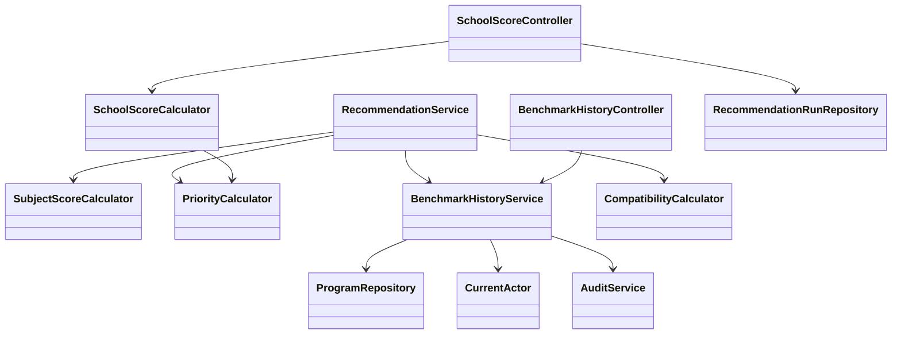
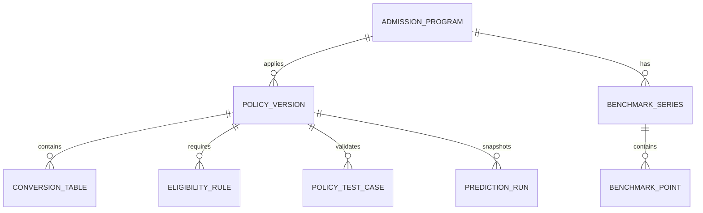
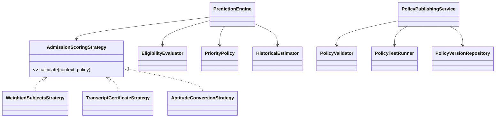

# Tính điểm tuyển sinh và đề xuất quản trị quy tắc

Cập nhật 21/10/2026. Phần tính điểm bên dưới đã triển khai; phần quản trị công thức cuối tài liệu là đề xuất, chưa triển khai.

Bổ sung cùng ngày: đã có 20 chương trình UET 2026 với điểm chuẩn chính thức và lịch sử theo nguồn, nhập/cập nhật Excel nhiều sheet và mức phù hợp từ nghề liên quan. Xem [EXCEL_IMPORT.md](EXCEL_IMPORT.md). Các bộ quy đổi riêng FTU bên dưới vẫn giữ phạm vi đã nêu; chưa có bộ quy đổi HSA riêng UET trong bản này.

## Phạm vi hiện tại

| Nhánh | Đã thực hiện | Giới hạn |
|---|---|---|
| THPT phổ thông | Chọn tổ hợp đủ ba môn, tổng thang 30, ưu tiên 2026, lịch sử ba năm theo tổ hợp | Không suy luận hệ số/công thức riêng từ tên trường. Chưa tính giải thưởng, điều kiện phụ |
| Ngoại thương 2026: ĐGNL | HSA, V-ACT thang 30; HSA, V-ACT, TSA cho nhóm tích hợp Khoa học máy tính/AI/Khoa học dữ liệu thang 40 | Chỉ nhóm chương trình hiển thị trong bộ chọn; không áp dụng mặc định cho mọi ngành |
| Ngoại thương 2026: kết hợp | Điểm trung bình từng môn qua lớp 10–12 + IELTS Academic, thang 30 hoặc Toán hệ số 2 thang 40 | Không áp dụng cho nhóm ngôn ngữ, luật; chưa tính thưởng giải thưởng, TOEFL, SAT, ACT, ĐGNL kết hợp chứng chỉ |
| Trường khác | Danh mục tra cứu THPT phổ thông hiện có | Chưa có bộ quy đổi riêng cho Bách khoa Hà Nội, UET, NEU. Không dùng công thức FTU cho các trường này |

Nguồn đã đối chiếu:

- [Chính sách ưu tiên 2026 — Cổng Thông tin Chính phủ](https://xaydungchinhsach.chinhphu.vn/chinh-sach-uu-tien-trong-tuyen-sinh-dai-hoc-119260227153842885.htm).
- [Thông tin xét tuyển Ngoại thương 2026](https://thongtintuyensinh.ftu.edu.vn/admissions-methods): mục 2.2, 2.3.2, 4.1, 4.2.1, III, IV. Đây là nguồn của catalog `FTU-2026-v1`; cần tái đối chiếu trước mỗi lần cập nhật quy tắc. Không coi bảng công thức là bảng điểm chuẩn từng ngành.

## Cách tính và giải thích kết quả

### THPT và ưu tiên

1. Chỉ tính tổ hợp có đủ ba điểm. Điểm thiếu không được thay bằng 0; nếu chọn một tổ hợp trên giao diện, chỉ gửi ba môn tương ứng.
2. Ưu tiên khu vực gốc: KV1 = 0,75; KV2NT = 0,50; KV2 = 0,25; KV3 = 0. Chỉ áp dụng trong năm tốt nghiệp và năm kế tiếp.
3. Ưu tiên đối tượng chọn một nhóm: ƯT1 = 2; ƯT2 = 1; không thuộc diện = 0. Không cộng nhiều nhóm cùng lúc.
4. Với tổng từ 22,5/30: ưu tiên thực = `(30 − tổng) / 7,5 × ưu tiên gốc`. Dưới ngưỡng giữ mức gốc. Thang 40 quy về thang 30 để xác định mức giảm, sau đó đổi ưu tiên về thang 40.
5. Dùng BigDecimal, giữ độ chính xác nội bộ 12 chữ số thập phân khi chia; ưu tiên và kết quả làm tròn HALF_UP đến 2 chữ số. Giới hạn tổng ở mức tối đa của thang điểm.
6. Kết quả THPT hiển thị riêng điểm ba môn, ưu tiên, tổng sau ưu tiên; mốc một năm cũ vẫn được ghi là đối chiếu điểm thô. Không đổi nhãn mốc mẫu thành dữ liệu đã kiểm chứng.

Ưu tiên 2026 không tự áp dụng cho năm khác. Đây là điểm theo công thức phổ thông, không phải kết luận điểm xét tuyển cuối cùng cho mọi trường.

### Mốc xu hướng ba năm

Với dự tuyển 2026, chỉ lấy 2025, 2024, 2023 đúng chương trình và tổ hợp. Admin phải xác nhận từng dòng đã kiểm tra nguồn và có thể so sánh: cùng cơ sở, mã chương trình, phương thức THPT, thang 30, không hệ số. Mọi dòng thiếu xác nhận đều bị loại.

`Est = 0,5 × điểm 2025 + 0,3 × điểm 2024 + 0,2 × điểm 2023`.

- Chênh nhỏ hơn −0,50: thấp hơn mốc.
- Chênh từ −0,50 đến +0,50: gần mốc, bao gồm hai biên.
- Chênh lớn hơn +0,50: cao hơn mốc.

Đây là **quy ước tư vấn**, không phải mô hình xác suất và không bảo đảm trúng tuyển. Không tạo các số 40%, 75%, 90% từ chênh điểm. Thiếu một năm thì trả trạng thái thiếu dữ liệu, không nội suy, chia lại trọng số hay lấy điểm của năm 2026 làm lịch sử dự báo cho chính 2026. Không so sánh lịch sử THPT với ĐGNL/học bạ.

Lịch sử lưu trong `programs.benchmark_history` (JSONB), bổ sung bằng migration V5; không xóa dữ liệu trước đó. Khi admin đổi trường, ngành, mã, năm dự tuyển hoặc tổ hợp, toàn bộ xác nhận tương thích cũ bị tắt để rà soát lại. Cập nhật có kiểm tra revision, ghi audit, chỉ admin được thực hiện.

### ĐGNL và học bạ kết hợp của Ngoại thương

Catalog hiện có 7 quy tắc được chọn ở server, không cho client gửi công thức hoặc sửa thang điểm:

- HSA thang 30: `27 + (điểm − 100) × 3 / 50`.
- V-ACT thang 30: `27 + (điểm − 850) × 3 / 350`.
- Hai công thức trên đổi thang 40 bằng nhân `4/3` cho nhóm tích hợp STEM được liệt kê.
- TSA cho nhóm tích hợp STEM: `[27 + (điểm − 70) × 3 / 30] × 4/3`.
- Học bạ: trung bình cả năm lớp 10–12 môn Toán + trung bình môn Vật lý/Hóa học/Ngữ văn + IELTS quy đổi. Nhóm tích hợp STEM nhân Toán hệ số 2.
- IELTS Academic: 6,5 → 8,5; 7 → 9; 7,5 → 9,5; từ 8 → 10. Không dùng bảng này cho trường khác.

Sau quy đổi mới tính ưu tiên trên đúng thang. Bản hiện tại áp dụng **không có điểm thưởng giải thưởng**; nếu thêm thưởng phải cộng trước ưu tiên, giới hạn và kiểm tra điều kiện đúng quy định FTU.

Kiểm tra điểm trong thang, năm thi 2026, ngưỡng HSA/V-ACT/TSA, phần 3 HSA, học tập và rèn luyện tự khai. Với học bạ: kiểm tra đủ sáu điểm cả năm, trung bình hai môn ≥ 8,5, nhóm học sinh chuyên/đạt giải phù hợp, tốt nghiệp 2026, IELTS theo bước 0,5, hiệu lực đến ít nhất 02/07/2026 và ngày cấp không sau hạn hồ sơ 23/06/2026. Nhập hai điểm thi THPT để kiểm tra đường ngưỡng hai môn + chứng chỉ quy đổi + ưu tiên ≥ 24. Chưa thực hiện đường kiểm tra ngưỡng bằng tổ hợp ba môn THPT thay thế, thẩm định giấy tờ, điều kiện chung, điều kiện ngưỡng bổ sung hoặc điều chỉnh sau công bố.

Điểm cao vẫn có thể đi kèm điều kiện chưa đạt. Trạng thái `declaredRequirementsMet` chỉ nói về các kiểm tra đã liệt kê, không phải xác nhận đủ điều kiện nộp hồ sơ của trường. Điểm và công thức vẫn hiển thị để người dùng hiểu số học; không phân loại cơ hội cho hai phương thức này khi chưa gắn lịch sử đúng mã chương trình.

### Hướng nghiệp và lưu kết quả

Holland chỉ ảnh hưởng thứ tự gợi ý THPT; không thay đổi điểm ba môn, ưu tiên hay Est. Bật/tắt cá nhân hóa vẫn hoạt động. Khi đăng nhập, yêu cầu và kết quả tính điểm được lưu snapshot trong `recommendation_runs`, gồm phiên bản, nguồn, phép tính, điều kiện và kết quả. Hiện chưa có giao diện lịch sử các lần tính điểm; lịch sử trắc nghiệm là chức năng riêng.

## Cấu trúc và API hiện tại

- `POST /api/recommendations`: bổ sung `priority` tùy chọn; trả `priorityScore`, `admissionScore`, `estimate` cùng dữ liệu cũ.
- `GET /api/admissions/policies`: catalog quy tắc đang hỗ trợ, có phạm vi, thang, năm, nguồn và version.
- `POST /api/admissions/calculate`: tính theo ID quy tắc server; yêu cầu CSRF, cho khách dùng, lưu snapshot nếu đăng nhập.
- `GET/PUT /api/admin/programs/{id}/benchmarks`: đọc/lưu toàn bộ lịch sử của chương trình, gồm revision, kiểm tra quyền ADMIN và CSRF khi ghi.

Các bộ tính là lớp Java độc lập với HTTP/database, được unit test trực tiếp; controller và service quản lý phiên, quyền và giao dịch. Catalog đang cố định trong code, chưa phải hệ thống plugin hay công thức tùy ý.

### Kiểm tra đã thực hiện

- Unit test: biên ưu tiên 22,49/22,50/27/30; hạn ưu tiên khu vực; thang 40; trọng số lịch sử và biên ±0,50; loại dữ liệu thiếu/chưa xác minh/khác tổ hợp; công thức HSA/V-ACT/TSA; sai năm/thang; IELTS và điểm học bạ thiếu.
- Integration test trên PostgreSQL riêng `huongnghiep_test`: migration V5, lưu/đọc lịch sử, revision cũ bị từ chối, quyền admin/student/khách và CSRF, tra cứu dùng lịch sử thật trong transaction, lưu snapshot quy tắc khi đăng nhập. Các dữ liệu kiểm thử nghiệp vụ được rollback, không đưa điểm chuẩn giả vào database sử dụng.
- Trình duyệt: tra cứu THPT 27 + KV1 → 27,30; HSA 125 → 28,50; học bạ Toán/Lý trung bình 9 + IELTS 6,5 → 26,50; kiểm tra biểu mẫu lịch sử admin và kết quả trên viewport 390 × 844, không tràn ngang.
- Frontend build TypeScript/Vite. Các cảnh báo chunk editor lớn có sẵn chưa được xử lý trong phạm vi tính điểm.

## Đề xuất: cho admin tạo và sửa cách tính điểm

**Chưa triển khai trong đợt này.** Nên dùng cấu hình có phiên bản thay vì cho nhập mã Java/JavaScript hoặc chuỗi công thức chạy trực tiếp.

### Luồng quản trị đề xuất

1. Chọn trường, cơ sở, mã chương trình, năm và phương thức; tạo nháp từ mẫu có sẵn.
2. Chọn loại công thức: tổng môn có trọng số; trung bình học bạ; quy đổi bảng bậc thang; quy đổi tuyến tính theo đoạn; tổng các thành phần.
3. Cấu hình môn/hệ số, thang điểm, bảng IELTS theo loại chứng chỉ, khoảng điểm ĐGNL, thời hạn, điều kiện nộp hồ sơ, điểm thưởng và thứ tự cộng ưu tiên.
4. Nhập nguồn chính thức, ngày hiệu lực và ghi chú thay đổi. Chỉ hỗ trợ các phép tính được định nghĩa trước, cấm script, hàm gọi mạng hoặc truy vấn database.
5. Chạy thử với bộ hồ sơ mẫu. Hiển thị từng bước và chênh lệch so với phiên bản hiện tại, kiểm tra biên, thang và điểm thiếu.
6. Xuất bản sau khi kiểm tra đạt. Mỗi phạm vi chỉ có một bản hiệu lực; giữ bản cũ để xem kết quả lịch sử và chọn phục hồi.

### Mô hình dữ liệu đề xuất

`POLICY_VERSION` có ID, phạm vi trường/chương trình/năm/phương thức, schemaVersion, engineVersion, config JSONB, status DRAFT/PUBLISHED/ARCHIVED, revision, nguồn, ngày hiệu lực, người tạo/xuất bản. Phiên bản đã xuất bản bất biến. Mỗi lần tính lưu cả ID và nội dung quy tắc được dùng.

`BENCHMARK_SERIES` lưu phương thức, thang, tổ hợp và phiên bản cách tính; chỉ cho so sánh qua các năm sau khi có xác nhận tương thích. Không mặc định rằng hai số cùng thang 30 có cùng ý nghĩa.

### Cấu trúc OOP đề xuất

Nên làm theo ba đợt: (1) chuẩn hóa phạm vi trường/chương trình và chuyển catalog hiện tại thành cấu hình; (2) trang nháp/chạy thử/xuất bản/khôi phục với audit và kiểm tra đồng thời; (3) thêm loại công thức và trường sau khi có bộ ví dụ chuẩn. Mỗi loại phép tính mới vẫn cần lập trình và kiểm thử; admin chỉ ghép/cấu hình các thành phần đã hỗ trợ.

Phần này độc lập với quản lý logic chấm quiz. Nếu mở rộng quiz, cần một `QuizScoringPolicy` riêng cho trọng số câu, đảo điểm và chuẩn hóa; không dùng chung cấu hình xét tuyển đại học.

### Nếu admin muốn đổi cách chấm trắc nghiệm

Giữ hai loại Holland/Đa trí tuệ hiện có, thêm chính sách chấm gắn chặt với từng phiên bản bộ câu hỏi. Admin có thể chọn thang trả lời, điểm từng đáp án, trọng số câu, câu đảo chiều, nhóm nhận điểm, cách chuẩn hóa và số nhóm nổi bật. Chỉ cho xuất bản nếu mọi nhóm có câu hợp lệ, trọng số không âm, mẫu số chuẩn hóa dương và các ca thử đạt.

Luồng vẫn là **tạo nháp → sửa câu và quy tắc → chạy thử đáp án → xem bảng điểm theo nhóm → xuất bản**. Bài làm đã nộp giữ nguyên phiên bản câu hỏi, chính sách và snapshot kết quả; đổi công thức không chấm lại lịch sử tự động. Hệ thống hướng nghiệp dùng điểm đã chuẩn hóa theo schema chung; nếu admin tạo loại quiz mới có nhóm khác RIASEC thì không tự dùng kết quả đó để tính tương đồng Holland. Cần khai báo cách gợi ý ngành tương ứng hoặc để kết quả chỉ dùng cho khám phá bản thân.
