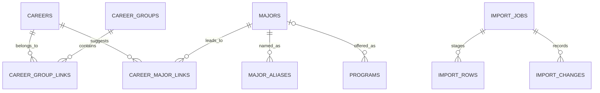
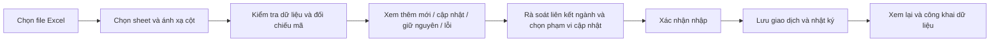
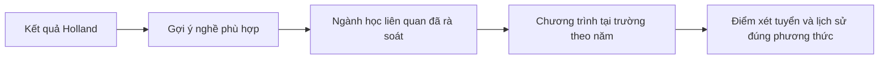
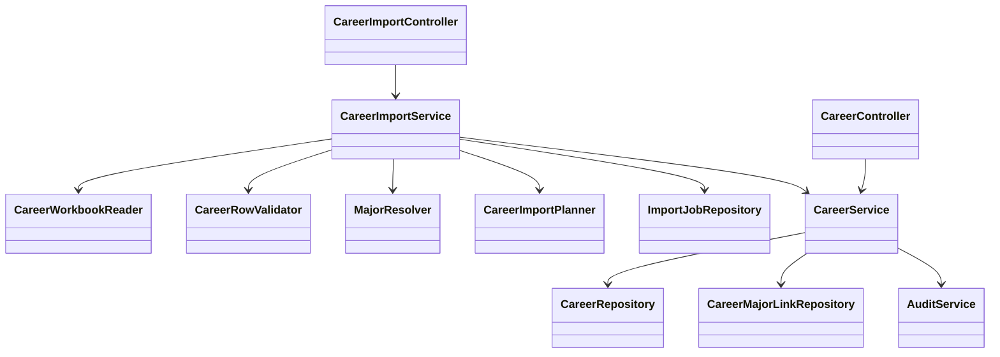

# Đề xuất nâng cấp danh mục nghề và nhập Excel

Ngày đánh giá: 21/10/2026. Tài liệu này lưu đề xuất ban đầu. Chức năng nhập/cập nhật Excel và danh mục có nguồn sau đó đã được triển khai; xem trạng thái và hướng dẫn thực tế tại [EXCEL_IMPORT.md](EXCEL_IMPORT.md). Những mục mở rộng trong đề xuất không đồng nghĩa tất cả đã được triển khai.

## 1. Kết quả kiểm tra file

Nguồn: `careers_final (3).xlsx`, sheet `Sheet1`, bảng dữ liệu thực tế `A1:G379`. File có định dạng mở rộng đến cột R, nhưng dữ liệu có tiêu đề gồm 7 cột dưới đây.

| Cột | Nội dung | Cách dùng đề xuất |
|---|---|---|
| A | Mã nghề (O*NET-SOC) | Khóa đối chiếu nghề khi nhập lại; lưu dạng chuỗi, giữ dấu chấm và số 0 cuối |
| B | Mã Holland (RIASEC) | Danh sách mã có thứ tự, gồm 1–3 ký tự trong file này |
| C | Tên nghề tiếng Anh (Gốc) | Tên gốc, phục vụ tìm kiếm và đối chiếu |
| D | Tên nghề tiếng Việt (Chuẩn hóa) | Tên hiển thị trên web |
| E | Mô tả ngắn tiếng Việt | Nội dung chi tiết nghề |
| F | Ngành đại học tương ứng tại Việt Nam | Danh sách tên ngành gợi ý, cần chuẩn hóa thành quan hệ nghề–ngành |
| G | Nhóm ngành lớn | Danh sách nhóm phân loại, phân cách bằng dấu chấm phẩy |

Đã đọc toàn bộ các dòng dữ liệu:

- **378 nghề**, mã O*NET-SOC và tên tiếng Anh không trùng; các mã nghề đều đúng mẫu `NN-NNNN.NN` về cú pháp. Chưa xác minh từng mã với danh mục O*NET chính thức hoặc phiên bản nguồn.
- Không có ô trống trong 7 cột dữ liệu, không có ô công thức hoặc lỗi Excel trong phần được đọc. Mã Holland không có ký tự ngoài R/I/A/S/E/C và không lặp ký tự trong cùng mã.
- Tách cột G bằng dấu `;` cho **41 tên nhóm khác nhau**, với **793 liên kết nghề–nhóm**. Đây là phân nhóm của bộ dữ liệu, chưa có căn cứ coi là danh mục nhóm ngành chính thức.
- Tách cột F bằng dấu phẩy cho **292 tên ngành ứng viên** và **1.132 liên kết nghề–tên ngành**. Đây là số tên văn bản khác nhau, chưa phải 292 ngành đào tạo chính thức đã được xác minh.
- Có hai nghề cùng tên tiếng Việt **Nữ hộ sinh**, tại dòng 331 và 366: mã `29-1161.00` và `29-9099.01`, tên tiếng Anh khác nhau. Không gộp hoặc ghi đè chỉ vì trùng tên tiếng Việt.
- So với `careers_final.csv` trong project: cùng 378 mã nghề; **24 dòng có nội dung thay đổi** trong 6 trường chung, gồm 22 thay đổi tên tiếng Việt và 2 thay đổi danh sách ngành. File Excel bổ sung trường Nhóm ngành lớn.

**Phân biệt quan trọng:** cột F chứa tên ngành học gợi ý tại Việt Nam. File không có mã ngành chính thức, trường, cơ sở, mã chương trình của trường, năm tuyển sinh, tổ hợp, phương thức, chỉ tiêu hay điểm chuẩn. Vì vậy, file phù hợp để xây danh mục nghề–ngành và gợi ý tìm hiểu; không được tự chuyển mỗi tên ngành thành một chương trình xét tuyển đã xác minh.

File cũng chưa có mức lương, kỹ năng, triển vọng, nguồn nội dung, năm dữ liệu hay điểm Holland liên tục cho đủ sáu nhóm. Các thông tin này cần nguồn khác hoặc cập nhật thủ công; không tự sinh số liệu để điền cho đủ giao diện.

## 2. Hiện trạng project và những phần cần đổi

- PostgreSQL đã có bảng `careers`, nhưng chỉ gồm `id` và `data JSONB`.
- API `GET /api/careers` đọc dữ liệu từ bảng đó; chưa có luồng quản trị nghề hoặc import Excel.
- Dữ liệu khởi tạo backend có 23 nghề. Seed chỉ chạy khi bảng nghề rỗng, nên sửa seed hoặc đặt file Excel vào project không cập nhật database đã có.
- Trang chủ, danh mục nghề và một số phần gợi ý còn dùng mảng 23 nghề cố định ở frontend. Chỉ sửa PostgreSQL sẽ chưa làm các trang này đổi dữ liệu.
- Bảng `programs` hiện lưu chương trình tại trường theo năm, có dữ liệu Holland riêng; chưa có danh mục ngành độc lập và quan hệ khóa ngoại nghề–ngành–chương trình.

Nâng cấp cần làm cả schema, API, cơ chế nhập và các trang đang đọc dữ liệu cố định.

## 3. Mô hình dữ liệu đề xuất

### Những bảng nên có trong lần nâng cấp này

| Bảng | Nội dung chính |
|---|---|
| `careers` | ID nội bộ ổn định; mã O*NET-SOC duy nhất; tên Anh/Việt; mô tả; mã Holland có thứ tự; trạng thái nháp/công khai/lưu trữ; revision; nguồn và lần import |
| `career_groups` | ID và tên 41 nhóm của bộ dữ liệu, có thể đổi tên mà không mất liên kết |
| `career_group_links` | Quan hệ nhiều–nhiều giữa nghề và nhóm |
| `majors` | ID nội bộ, tên ngành chuẩn, mã ngành chính thức nếu đã kiểm chứng; trạng thái chờ chuẩn hóa/đã xác minh |
| `major_aliases` | Tên gọi khác và khóa chuẩn hóa để tìm đúng ngành, tránh nhập trùng tên gần giống |
| `career_major_links` | Quan hệ nhiều–nhiều nghề–ngành, lưu nguồn và trạng thái rà soát |
| `import_jobs` | Người nhập, thời điểm, profile/schemaVersion, checksum file, trạng thái, số dòng và kết quả |
| `import_rows` | Sheet/dòng nguồn, giá trị gốc, dữ liệu chuẩn bị nhập, lỗi/cảnh báo và thao tác dự kiến |
| `import_changes` | Bản trước/sau, entity ID, revision, trường thay đổi để truy vết và khôi phục có kiểm soát |

Giữ bảng `programs` đang có, bổ sung `major_id` nullable trỏ đến `majors`. Việc gắn chương trình vào ngành phải được rà soát; chưa khớp thì để trống, không đoán theo tên rồi công khai thành liên kết chính thức.

### Giữ tương thích với dữ liệu cũ

Giữ ID nghề hiện có để bookmark và liên kết cũ tiếp tục hoạt động. Bổ sung mã O*NET và các trường chuẩn bằng migration mới, không xóa bảng để tạo lại. Nghề mới có ID nội bộ mới nhưng được đối chiếu khi import bằng mã O*NET, không phải số thứ tự dòng hay tên tiếng Việt.

Lập bảng đối chiếu 23 nghề cũ với file mới. Chỉ hợp nhất khi xác nhận đúng nghề; trường hợp một nghề cũ rộng hơn hoặc hẹp hơn một mã O*NET thì để admin quyết định. Giữ thông tin kỹ năng/lương được biên tập riêng nếu file mới không chứa các cột đó.

Nguồn do người dùng cung cấp khác với trạng thái đã xác minh: lưu provenance là file/lần import, nhưng không tự đặt `verified=true`. Mã ngành chính thức còn thiếu phải nullable, không dùng mã O*NET làm mã ngành.

### Xử lý nhóm và ngành trong cùng một dòng

- Cột F và G là hai danh sách độc lập. Không ghép phần tử thứ nhất của F với phần tử thứ nhất của G, và không tạo tích chéo ngành–nhóm từ việc chúng xuất hiện chung trong dòng.
- Với profile file hiện tại: F tách bằng dấu phẩy, G tách bằng dấu chấm phẩy. Những file sau có dấu phân cách khác phải chọn profile hoặc điều chỉnh mapping, không tự tách mọi dấu câu.
- Chuẩn hóa khoảng trắng, Unicode và biến thể dấu gạch cho việc tìm ứng viên. Giữ nguyên tên gốc để đối chiếu; không bỏ dấu tiếng Việt để tự động hợp nhất các tên mơ hồ.
- Tên ngành đã có alias chính xác thì liên kết lại; tên chưa biết được tạo ở trạng thái chờ chuẩn hóa hoặc đưa vào danh sách cần xử lý. Gợi ý gần giống chỉ để admin chọn, không tự ghi đè.
- Một nghề có thể thuộc nhiều nhóm và gợi ý nhiều ngành. Nhóm STEM S/T/E/M trên giao diện là một lớp phân loại khác; cần bảng ánh xạ được rà soát, không suy ra cứng từ chữ đầu của tên nhóm.

## 4. Luồng nhập Excel cho admin

Vị trí đề xuất: **Quản trị nội dung → Dữ liệu nghề nghiệp → Nhập Excel**.

### Nhận file

Đợt đầu hỗ trợ `.xlsx` như file đã gửi. Không yêu cầu giữ nguyên tên file hay thứ tự cột. Cần giữ tên cột được nhận biết hoặc cho admin ánh xạ tên cột vào trường hệ thống. Hỗ trợ cả tiêu đề tiếng Việt của file này và bộ tiêu đề tiếng Anh trong CSV cũ nếu sau đó bổ sung định dạng CSV.

Chỉ tài khoản ADMIN được tải lên, xem dữ liệu staging và xác nhận nhập. Đề xuất ban đầu giới hạn 10 MB và 10.000 dòng; đây là cấu hình sản phẩm có thể điều chỉnh sau đo tải. Kiểm tra nội dung định dạng, dung lượng giải nén và số sheet/dòng, không chỉ phần mở rộng. Không chạy macro, công thức hoặc liên kết ngoài của file. Nếu gặp công thức trong cột dữ liệu bắt buộc thì báo rõ dòng cần chuyển thành giá trị.

### Xem trước thay đổi

Ghi vào vùng staging trước, chưa sửa danh mục đang công khai. Mỗi dòng có:

- Sheet và số dòng Excel để người nhập sửa đúng chỗ.
- Thao tác dự kiến: thêm mới, cập nhật, giữ nguyên hoặc cần xử lý.
- Các trường thay đổi, giá trị trước và sau.
- Ngành/nhóm sẽ tạo mới, liên kết lại hoặc đang chờ chuẩn hóa.
- Lỗi cụ thể: thiếu mã, mã trùng trong file, mã Holland sai, tên bắt buộc trống, quan hệ chưa khớp.

Mặc định chặn xác nhận nếu có lỗi nghiêm trọng, để lần nhập là một giao dịch trọn vẹn. Cảnh báo nội dung/chuẩn hóa có thể được nhập ở trạng thái nháp nếu admin đã xem và chủ động chọn. Không lặng lẽ bỏ qua dòng lỗi rồi báo thành công toàn bộ.

### Lưu và công khai

Khi admin xác nhận, server kiểm tra lại quyền, checksum/nội dung staging, trạng thái job và revision các bản ghi. Dữ liệu đã đổi sau lúc preview thì trả xung đột, yêu cầu tạo preview mới. Một job chỉ được áp dụng một lần; bấm hai lần hoặc gửi lại yêu cầu không nhân đôi bản ghi.

Tạo/cập nhật nghề và quan hệ trong transaction, ghi snapshot trước/sau và audit. Sau commit mới làm mới danh mục/cache của giao diện. Giao diện hiển thị đúng tổng số thêm/cập nhật/không đổi/lỗi và ai đã thực hiện. Công khai là thao tác riêng hoặc bước lựa chọn rõ ràng sau khi rà soát, không đồng nghĩa file hợp lệ là nội dung đã được xác minh.

## 5. Các lần cập nhật về sau

| Tình huống | Hành vi mặc định đề xuất |
|---|---|
| Mã nghề mới | Tạo mới ở trạng thái nháp để rà soát |
| Mã nghề đã có, nội dung đổi | Cập nhật các cột admin cho phép, giữ ID nội bộ |
| Mã nghề đã có, nội dung không đổi | Giữ nguyên, không tạo bản ghi nghề mới |
| Hai dòng trùng mã trong cùng file | Báo lỗi, không dùng quy tắc dòng cuối ghi đè |
| Hai mã khác nhau trùng tên Việt | Giữ hai nghề, cảnh báo trùng tên để rà soát |
| File thiếu một nghề từng nhập trước đó | Giữ nghề trong database, không tự xóa |
| Cột không tồn tại trong file | Không thay đổi trường tương ứng trong database |
| Ô trống của trường tùy chọn | Mặc định giữ giá trị cũ; xóa giá trị phải chọn rõ trong preview |
| Ngành/nhóm trong một dòng thay đổi | Preview quan hệ sẽ thêm/bỏ; chỉ thay thế phần do nguồn import quản lý khi admin chọn, giữ liên kết biên tập thủ công |
| Cùng file được tải lại | Báo đã nhập; có thể xem lại hoặc tạo preview đối chiếu mới, không áp dụng job cũ lần hai |
| Mã nghề O*NET thay đổi giữa phiên bản | Xử lý qua mapping thay mã/hợp nhất có kiểm tra, không đoán theo tên |

Cho phép hai chế độ nhập: **chỉ thêm mới** và **thêm mới + cập nhật theo mã**. Chưa nên làm chế độ thay thế toàn bộ danh mục hoặc xóa các bản ghi không có trong file.

Ví dụ lần đầu file này có thể tạo danh mục 378 mã nghề sau khi xử lý đối chiếu với 23 nghề cũ. Lần sau sửa mô tả một mã thì cập nhật đúng mã đó. Bỏ một dòng khỏi Excel không xóa nghề khỏi web. Muốn ngừng dùng một nghề, admin chọn lưu trữ; bài quiz, bookmark và kết quả đã lưu vẫn giữ được tham chiếu.

Khôi phục một lần import là giao dịch bù có kiểm tra: chỉ khôi phục tự động nếu các bản ghi vẫn ở revision được tạo bởi lần đó. Nếu đã có sửa tay hoặc import tiếp theo thì hiển thị xung đột để xử lý từng bản ghi, không ghi đè các sửa đổi mới. Bản ghi mới có thể được lưu trữ thay vì xóa khi đã có người dùng tham chiếu. Sao lưu database vẫn cần cho khôi phục sự cố toàn hệ thống.

## 6. Liên kết với quiz và tra điểm

- Giữ thứ tự mã Holland trong Excel. Mã như `IRC` là phân loại có thứ tự, không phải ba giá trị điểm và không cung cấp vector sáu chiều đầy đủ. Không tự gán thành `I=100, R=75, C=50` rồi coi là dữ liệu đo lường của nguồn.
- Có thể bổ sung bộ đối sánh mã Holland nghề với kết quả quiz, nhưng phương pháp/trọng số phải được đặt tên, có phiên bản và giải thích. Đây là thuật toán tư vấn của ứng dụng, không phải dữ liệu điểm do Excel cung cấp. Giai đoạn đầu có thể dùng mã để lọc nghề liên quan và giữ cơ chế xếp hạng tuyển sinh hiện có.
- Ngành liên quan đến nhiều nghề nên ưu tiên cách tổng hợp tránh thiên lệch: không cộng tất cả nghề để ngành có nhiều liên kết luôn đứng đầu. Có thể dùng mức phù hợp cao nhất hoặc trung bình nhóm nghề nổi bật, sau đó kiểm thử và công bố rõ cách tính.
- Nếu ngành chưa được liên kết với chương trình thật tại trường, chỉ hiển thị tên ngành và trạng thái chưa có dữ liệu tuyển sinh. Không tự tạo trường, điểm chuẩn hoặc tỷ lệ đỗ.
- Giữ tùy chọn có/không dùng kết quả quiz khi tra điểm. Độ phù hợp nghề/ngành chỉ thay đổi cách sắp xếp và giải thích, không cộng vào điểm xét tuyển.

## 7. Thay đổi giao diện và API

### Giao diện người dùng

- Trang Ngành nghề, trang chủ và kết quả quiz chuyển sang đọc API dùng chung, không duy trì thêm một mảng nghề cố định song song.
- Danh mục 378 nghề cần tìm kiếm, phân trang và lọc theo nhóm/Holland. Bộ lọc mức lương/kỹ năng chỉ dùng khi có dữ liệu, không xem giá trị thiếu là 0 hoặc tự bịa để đủ trường hiển thị.
- Chi tiết nghề có mô tả, nhóm, mã Holland, ngành Việt Nam liên quan và nút xem chương trình tại trường nếu đã có liên kết.
- Giữ dữ liệu JSONB bổ sung khi phù hợp, nhưng các khóa dùng tìm kiếm, liên kết và chống trùng nên là trường có ràng buộc rõ ràng.

### API đề xuất, chưa có trong bản hiện tại

- `GET /api/careers?q=&group=&holland=&page=&size=`: danh mục công khai có phân trang.
- `GET /api/careers/{id}` và `GET /api/careers/{id}/programs?year=2026`.
- CRUD admin cho nghề, nhóm, ngành, alias và liên kết; có revision, nguồn, trạng thái xuất bản/lưu trữ.
- `POST /api/admin/career-imports/preview`: nhận file và mapping, trả job, thống kê và trang dòng preview.
- `GET /api/admin/career-imports/{id}` và danh sách lịch sử import.
- `POST /api/admin/career-imports/{id}/commit`: xác nhận job đã chuẩn bị, kiểm tra lại revision.
- `POST /api/admin/career-imports/{id}/revert-preview` và `/revert`: preview/áp dụng khôi phục có kiểm soát.

API `/api/careers` hiện trả mảng; khi thêm phân trang cần cập nhật consumer cùng lúc hoặc giữ phiên bản tương thích trong thời gian chuyển đổi.

## 8. Cấu trúc Java/Spring Boot đề xuất

`CareerWorkbookReader` chỉ đọc file thành DTO gồm sheet/dòng và trường thô. Validator kiểm tra dữ liệu. Resolver chuẩn hóa/liên kết tên ngành. Planner tính khác biệt, không ghi vào danh mục. Service quản lý phân quyền, giao dịch, idempotency và audit. Không viết toàn bộ xử lý Excel trong controller hoặc cho file chạy câu lệnh SQL.

Spring Boot nhận multipart file; dùng Apache POI để đọc `.xlsx`, khóa phiên bản dependency đã được kiểm tra trong project. PostgreSQL dùng ràng buộc duy nhất theo mã để chống trùng ở database; xử lý upsert không được bỏ qua service nghiệp vụ, quyền và kiểm tra revision.

Tài liệu kỹ thuật đối chiếu: [Apache POI spreadsheet guide](https://poi.apache.org/components/spreadsheet/quick-guide.html), [Spring file upload guide](https://spring.io/guides/gs/uploading-files/), [PostgreSQL INSERT / ON CONFLICT](https://www.postgresql.org/docs/current/sql-insert.html).

## 9. Mẫu Excel cho tương lai

Đợt đầu đọc được **đúng file 7 cột hiện tại**, không buộc người dùng soạn lại. Sau khi có danh mục ngành chuẩn, nên bổ sung chức năng tải mẫu/đối chiếu có ID để cập nhật quan hệ chính xác hơn.

Hai loại dữ liệu nên dùng hai profile nhập riêng:

1. **Danh mục nghề**: 7 cột hiện tại; về sau có thể thêm mã ngành, nguồn, ngày dữ liệu và trạng thái theo schemaVersion. Đối với quan hệ phức tạp có thể dùng sheet liên kết nghề–ngành, mỗi dòng một cặp mã thay vì chuỗi tên.
2. **Chương trình và tuyển sinh**: trường/cơ sở, mã chương trình của trường, mã ngành, năm, phương thức, tổ hợp, thang/công thức, điểm chuẩn và nguồn. Cần reader/validator khác, không lấy công thức tuyển sinh từ cột mô tả nghề.

Tên file tùy ý; profile/schema mới phải được nhận biết và kiểm tra trước khi import. Thiếu trường bắt buộc hoặc quan hệ không hợp lệ thì báo đúng sheet/dòng/cột, không nhập nhầm kiểu dữ liệu.

## 10. Trình tự triển khai

1. **Chuẩn hóa và nối dữ liệu:** migration giữ ID cũ, thêm danh mục nhóm/ngành/quan hệ, lập đối chiếu 23 nghề cũ, chuyển các trang sang API; preview file 378 nghề và rà soát các liên kết.
2. **Import dùng được cho admin:** đọc file hiện tại, kiểm tra/preview/diff, nhập theo mã trong transaction, nhật ký và kiểm tra quyền/đồng thời. Nạp dữ liệu đã rà soát mà không xóa nội dung biên tập ngoài nguồn.
3. **Hoàn thiện cập nhật dài hạn:** trình chuẩn hóa alias, gắn chương trình trường/năm, đối sánh Holland có phiên bản, khôi phục import và mẫu xuất ra để cập nhật.

Kiểm thử trọng tâm: đọc đủ 378 dòng; nhập lại không nhân đôi; trùng tên Việt vẫn giữ đúng mã; thay một dòng chỉ cập nhật đúng trường được chọn; thiếu nghề trong file không tự xóa; không ghi đè kỹ năng/lương thiếu cột; nhiều nhóm/ngành không tạo quan hệ sai; lỗi hoặc xung đột không ghi dở; student/khách không được import; thay đổi danh mục xuất hiện đồng nhất ở trang chủ, danh mục và gợi ý quiz.

Đây là nâng cấp dữ liệu ứng dụng qua Excel, không phải chức năng phục hồi một bản sao database SQL. Điểm chuẩn và chính sách tính điểm vẫn được quản lý theo từng trường, năm và phương thức riêng.
