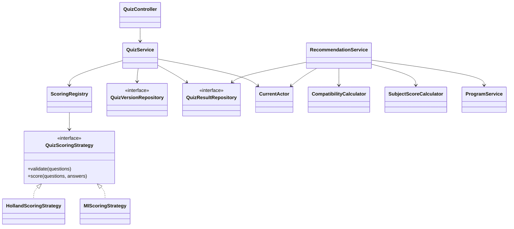

# Phạm vi khung triển khai — 21/10/2026

Cập nhật 22/10/2026 (local): quản lý nghề chỉ dùng khớp tag; đã bỏ yêu cầu chọn ngành và chương trình thủ công. INCLUDE/MAJOR/EXPLICIT cũ không còn quyết định gợi ý; giữ loại trừ/khôi phục. Thông tin ngành nhập Excel được giữ để tham khảo, không xóa dữ liệu cũ. Chi tiết tại [TAG_MATCHING.md](TAG_MATCHING.md).

Đã bổ sung quản lý trường (V10): bảng `schools`, khóa ngoại chương trình, thêm/sửa trường, ẩn/khôi phục và chỉ xóa trường trống. Trường ẩn bị loại ở danh sách trường, API chương trình, tra điểm và liên kết nghề. Form chương trình chọn trường theo ID; các luồng Excel/seed vẫn tương thích mã trường cũ. Kiểm tra: 63 bài Java, 62 đạt và 1 Docker bỏ qua; frontend build thành công. [Cách dùng](SCHOOL_MANAGEMENT.md).

Cập nhật hiện tại: 45 tag định hướng; 1.275 dòng chương trình và 4.678 ô điểm dạng số từ file 35 trường/cơ sở. Có trang `/truong` và nhóm chương trình theo trường trong admin. Giữ nguyên điểm/công thức nguồn, phân biệt các phương thức; không tự tính công thức chưa rõ. 59 bài Java: 58 đạt, 1 Docker bỏ qua; frontend build thành công, đã đối chiếu số liệu qua API thật. Database đã được sao lưu trước cập nhật. [Phạm vi và vận hành](DATASET_35_SCHOOLS.md). Kiểm tra trực quan trên Edge chưa thực hiện được do bộ duyệt chặn truy cập cửa sổ ngoài phạm vi; không coi kiểm tra API là kiểm tra hiển thị.

Mới nhất: Migration V8 và bộ tag dùng chung, gắn tag theo ID, khớp theo tỷ lệ tag nghề, quyết định INCLUDE/EXCLUDE/RESET và giữ liên kết cũ. Có form quản lý tag, gắn tag cho nghề/chương trình và rà soát gợi ý. 57 bài kiểm thử Java: 56 đạt, 1 Docker bỏ qua; frontend build thành công. Database đang chạy có 299 tag khởi đầu; kiểm tra API thật nghề phần mềm có 3 tag, khớp 6 chương trình. Chi tiết tại [TAG_MATCHING.md](TAG_MATCHING.md).

Bổ sung quản trị nghề trực tiếp và chọn chương trình cụ thể: Migration V7 tạo bảng nhiều–nhiều `career_program_links`. Admin có thể thêm/sửa nghề, chọn ngành và chọn chương trình có sẵn; chế độ EXPLICIT chỉ dùng chương trình được chọn, chế độ MAJOR giữ cơ chế suy ra theo ngành. Có kiểm tra quyền, CSRF, revision và nhật ký. Kiểm tra sau bổ sung: 54 bài Java, 53 đạt, 1 bài Docker bỏ qua; frontend build thành công, API admin đang chạy trả 34 chương trình để chọn.

Kiểm tra mới nhất cho danh mục và nhập Excel: 52 bài kiểm thử Java, 51 đạt và 1 bài Testcontainers bỏ qua vì máy chưa có Docker; có kiểm thử tích hợp với PostgreSQL riêng. Frontend build thành công. Đã kiểm tra mẫu Excel qua giao diện admin (không lỗi, nhận đủ các sheet), mức phù hợp nghề, tắt cá nhân hóa và bố cục mobile không tràn ngang. Những con số kiểm thử ở các ghi chú cũ bên dưới là kết quả của những đợt trước.

## Đã có mã và đã kiểm tra

- Java 21, Spring Boot, Maven; PostgreSQL, Spring Data JPA/Hibernate, Flyway và Spring Session JDBC.
- Chỉ hỗ trợ tài khoản/mật khẩu. Đã gỡ Google OAuth2/OIDC khỏi frontend, cấu hình backend và dependency.
- Đăng ký và đăng nhập tài khoản/mật khẩu qua Spring Security DAO, BCrypt, CSRF và phiên JDBC; kiểm tra tài khoản trùng không phân biệt hoa/thường. Đăng ký chỉ nhận quyền học sinh.
- Bootstrap admin cục bộ bằng cấu hình riêng, không có mật khẩu mặc định hoặc nâng quyền tài khoản có sẵn; đã kiểm tra đăng nhập và vào giao diện admin thật.
- Role học sinh/admin, kiểm tra tài khoản còn hoạt động và quyền ở backend; dữ liệu cá nhân lấy theo tài khoản hiện hành.
- Holland và Đa trí tuệ dưới dạng strategy, kiểm tra đủ câu/nhóm, chuẩn hóa theo số câu từng nhóm; domain chấm điểm không phụ thuộc Spring/JPA.
- Tạo bản nháp mới, chọn bộ quiz đang dùng hoặc chọn lại bản lưu trữ, tự lưu trữ bộ trước cùng loại; kết quả trỏ đúng phiên bản, không sửa nội dung bản đã công khai.
- Chấm và lưu bài; nhận bài khách gần nhất vào tài khoản; lịch sử, hồ sơ điểm và yêu thích.
- Admin thêm/sửa chương trình/ngành tại trường, tổ hợp ba môn, hồ sơ Holland, mốc tham khảo và nguồn. Có optimistic locking và nhật ký.
- Cá nhân hóa từ **kết quả quiz phía server đã kiểm tra quyền sở hữu**, không nhận điểm Holland tùy ý từ trình duyệt.
- Ba chế độ sắp xếp, không sửa tổng điểm môn học khi đổi kết quả Holland; thiếu môn không coi là 0; vector 0 không sinh NaN.
- Công tắc bật/tắt quiz khi tra cứu: tắt thì không gửi, không đọc và không áp dụng kết quả Holland, chỉ dùng điểm môn học.
- Snapshot đề xuất của người đăng nhập lưu đầu vào, kết quả, hồ sơ chương trình và mã thuật toán.
- Frontend chọn chế độ demo/API thật; màn hình quiz, tra cứu, hồ sơ và quản trị. API thật không bị MSW che trong dev.
- Danh mục hiện có 378 nghề từ Excel, bổ sung hồ sơ sở thích O*NET 31.0 và kỹ năng khi có dữ liệu. Import Excel có mẫu, preview, xác nhận, lịch sử và hoàn tác; xem [quy tắc Excel](EXCEL_IMPORT.md). Đã bổ sung 20 chương trình UET năm 2026 từ nguồn chính thức, kèm lịch sử những năm có dữ liệu; dữ liệu mẫu cũ giữ trạng thái chưa xác minh.
- Migration/schema đã chạy trên PostgreSQL cục bộ. Có test dùng PostgreSQL riêng và tùy chọn Testcontainers.

Kiểm tra tại máy phát triển: 27 test Java đã qua (14 test không cần database và 13 test với PostgreSQL thật), 1 test Docker được bỏ qua do chưa có Docker. Bản sửa lịch sử/hồ sơ/phiên bản quiz đã build frontend thành công; các kiểm tra lint ở đợt trước đã qua. Kiểm thử mới bao gồm quyền xem/xóa/khôi phục bài làm, chặn dùng bài đã xóa để tra cứu và trả lại điểm học tập đã lưu. Đã kiểm tra trình duyệt mở lại bài trong lịch sử, tự điền điểm/năm dự tuyển và tạo bản nháp Holland phiên bản 2 từ bộ 24 câu đang có. Các kiểm tra này không thay cho kiểm định dữ liệu tuyển sinh hay nghiệm thu production.

## Cấu trúc OOP hiện tại

Các repository hiện là interface Spring Data; service điều phối giao dịch và mapper DTO thủ công. Một số chức năng hồ sơ/yêu thích có controller nhỏ gọi persistence trực tiếp. Việc tách cổng repository/adapter và domain entity đầy đủ theo kiến trúc đích vẫn là bước tiếp theo, không được mô tả là đã hoàn tất.

## Giới hạn có chủ đích của khung

- Tính THPT phổ thông có ưu tiên 2026 và mốc lịch sử ba năm; bổ sung 7 quy tắc Ngoại thương 2026 cho HSA/V-ACT/TSA và học bạ + IELTS. Phạm vi, giới hạn và đề xuất admin quản lý công thức được mô tả tại [ADMISSIONS_ENGINE.md](ADMISSIONS_ENGINE.md). Không công bố xác suất đỗ hoặc xác nhận hồ sơ hợp lệ.
- Admin quản lý “ngành trong chương trình tại trường” trước; danh mục ngành độc lập, cơ sở, đợt tuyển sinh và quan hệ nghề–ngành chuẩn hóa đầy đủ còn nằm trong kiến trúc mục tiêu.
- Câu hỏi/hồ sơ/chương trình dùng JSONB có kiểm tra; ERD trong README mô tả các bảng và quan hệ hiện tại. Chuẩn hóa thêm danh mục trường/ngành thuộc bước sau; thay đổi schema sẽ dùng migration mới.
- Bài khách gắn với phiên có thời hạn; chưa có autosave từng câu, resume nhiều thiết bị hoặc idempotency key bền vững cho các yêu cầu nộp đồng thời. Việc gửi lại cùng đáp án trong cùng phiên được dùng lại kết quả, nhưng chưa phải bảo đảm idempotency toàn hệ thống.
- Bookmark đang lưu snapshot với mã tham chiếu; chuẩn hóa đích bằng khóa ngoại thuộc bước sau.
- Chưa có giao diện quản lý người dùng/nhật ký đầy đủ, phân trang mọi danh mục, chính sách xóa tài khoản, quan sát vận hành hay triển khai production.
- Rate limiting mới áp dụng cho đăng nhập/đăng ký mật khẩu trên một backend; chưa phủ toàn bộ endpoint. Đã có đổi mật khẩu tại Hồ sơ: kiểm tra mật khẩu cũ, xác nhận mật khẩu mới, BCrypt, audit và thu hồi các phiên mật khẩu. Chưa có quên mật khẩu hay xác minh email.
- Upload media và bộ dữ liệu tuyển sinh chính thức cần cấu hình/kiểm chứng riêng.
- Đã có nhập/xuất Excel bằng Apache POI 5.5.1, preview/commit/revert, template chuẩn và kiểm tra tham chiếu nhiều sheet. Xem [EXCEL_IMPORT.md](EXCEL_IMPORT.md) cho phạm vi thực tế và nguồn dữ liệu.

## Giao diện tối giản, ưu tiên điện thoại

- Giao diện STEM Compass dùng Inter, Deep Blue và Neon Teal; trang chủ có bản đồ STEM tương tác, điều hướng chính Trang chủ / Ngành nghề / Trắc nghiệm / Tra điểm. Các trang phụ dùng cùng bảng màu.
- Trang `/nganh-nghe` sử dụng danh mục nghề hiện có ở frontend, tìm kiếm không dấu, lọc nhóm S/T/E/M hoặc nhóm khác, mức lương tham khảo và kỹ năng; có xem chi tiết và lưu yêu thích. Phân nhóm là cấu hình giao diện, dữ liệu lương vẫn chưa xác minh.
- Quiz có đồng hồ đếm ngược thời gian gợi ý, tạm dừng khi về màn hình chọn bài; hết giờ vẫn được trả lời, không tự nộp.
- Tra cứu có ba phương thức gọi backend: THPT phổ thông + ưu tiên 2026 + lịch sử ba năm có kiểm tra nguồn; ĐGNL và học bạ + IELTS theo catalog Ngoại thương 2026. Mỗi kết quả có cách tính và điều kiện đã kiểm tra; không áp dụng công thức chung cho mọi trường. Chưa có lịch sử tương thích từng mã chương trình cho hai phương thức Ngoại thương, nên chỉ tính điểm và kiểm tra điều kiện tự khai ở hai tab này.
- Luồng quiz kết nối backend hiển thị một câu mỗi màn hình, thanh tiến độ, thẻ chọn bo góc, nút quay lại/tiếp theo và phím tắt 1–5. Đáp án giữ trong bộ nhớ khi quay lại câu trước; chưa có lưu nháp qua lần tải lại trang.
- Kết quả Holland dùng bento grid: nhóm sở thích, điểm từng nhóm, tối đa ba ngành khác nhau từ API gợi ý và ba bước học từ danh mục kỹ năng hiện có. Kết quả Đa trí tuệ hiển thị hướng học tương ứng, không dùng thay cho hồ sơ Holland.
- Trang kết quả nối tới tra cứu bằng ID bài Holland trong phiên. Người dùng chủ động bật/tắt kết hợp sở thích; khi tắt, yêu cầu tra cứu chỉ gửi điểm và không gửi ID bài quiz. Thay đổi dữ liệu nhập sẽ xóa danh sách gợi ý cũ để tránh hiểu nhầm.
- Bố cục co về một cột trên điện thoại, có menu di động, nhãn biểu mẫu, trạng thái lựa chọn, focus bàn phím và hỗ trợ giảm chuyển động theo thiết lập hệ điều hành.
- Đã kiểm tra trực tiếp trên trình duyệt ở desktop và viewport 390 × 844: hoàn thành 24 câu Holland, hiển thị ba ngành, tra cứu với điểm và sở thích, tắt kết hợp quiz. Bản build TypeScript/Vite được kiểm tra sau chỉnh sửa.

## Dữ liệu nghề và Excel đã triển khai

Module `careers` chứa reader, validator/planner, import service, bổ sung chương trình và export. Migration V6 chuẩn hóa nhóm, ngành và quan hệ, giữ ID cũ; lần import có staging, checksum, revision và snapshot. Seed ban đầu nạp 378 nghề, dữ liệu O*NET 31.0 và 20 chương trình UET có nguồn. Giao diện chính đọc API thay cho mảng nghề cố định; mức phù hợp lấy bài Holland có kiểm tra quyền. Các bộ tính tuyển sinh không nhận công thức tùy ý từ Excel.

## Các bước tiếp theo

1. Hoàn thiện HTTPS và quy trình khôi phục tài khoản; quản lý quyền admin.
2. Rà soát nội dung quiz và hồ sơ Holland ngành cùng người có chuyên môn.
3. Chuẩn hóa nguồn tuyển sinh, thiết kế từng quy tắc và bộ kiểm thử theo tài liệu chính thức.
4. Hoàn thiện bài làm/phiên bản, phân trang, hạn mức, đồng thời và quyền chi tiết.
5. Hoàn thiện quản trị người dùng, nghề, nội dung, sao lưu/khôi phục và triển khai.
6. Mở rộng nguồn tuyển sinh, quy tắc có hệ số và nhập Excel cho các phương thức ngoài THPT sau khi có mô hình và bộ kiểm thử tương ứng.
