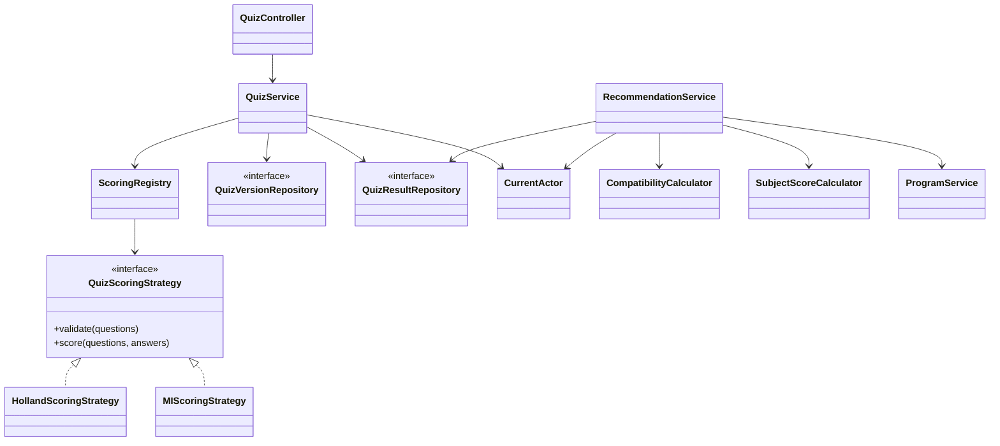

# Phạm vi khung triển khai — 19/10/2026

## Đã có mã và đã kiểm tra

- Java 21, Spring Boot, Maven; PostgreSQL, Spring Data JPA/Hibernate, Flyway và Spring Session JDBC.
- Luồng Google OAuth2/OIDC phía backend; không bật nếu chưa cấu hình client. Chưa xác minh đăng nhập Google thật do chưa có thông tin OAuth của đơn vị.
- Đăng ký và đăng nhập tài khoản/mật khẩu qua Spring Security DAO, BCrypt, CSRF và phiên JDBC; kiểm tra tài khoản trùng không phân biệt hoa/thường. Đăng ký chỉ nhận quyền học sinh.
- Bootstrap admin cục bộ bằng cấu hình riêng, không có mật khẩu mặc định hoặc nâng quyền tài khoản có sẵn; đã kiểm tra đăng nhập và vào giao diện admin thật.
- Role học sinh/admin, kiểm tra tài khoản còn hoạt động và quyền ở backend; dữ liệu cá nhân lấy theo tài khoản hiện hành.
- Holland và Đa trí tuệ dưới dạng strategy, kiểm tra đủ câu/nhóm, chuẩn hóa theo số câu từng nhóm; domain chấm điểm không phụ thuộc Spring/JPA.
- Tạo bản nháp mới, xuất bản quiz, lưu trữ bản trước; kết quả trỏ đúng phiên bản, không sửa nội dung bản đã công khai.
- Chấm và lưu bài; nhận bài khách gần nhất vào tài khoản; lịch sử, hồ sơ điểm và yêu thích.
- Admin thêm/sửa chương trình/ngành tại trường, tổ hợp ba môn, hồ sơ Holland, mốc tham khảo và nguồn. Có optimistic locking và nhật ký.
- Cá nhân hóa từ **kết quả quiz phía server đã kiểm tra quyền sở hữu**, không nhận điểm Holland tùy ý từ trình duyệt.
- Ba chế độ sắp xếp, không sửa tổng điểm môn học khi đổi kết quả Holland; thiếu môn không coi là 0; vector 0 không sinh NaN.
- Công tắc bật/tắt quiz khi tra cứu: tắt thì không gửi, không đọc và không áp dụng kết quả Holland, chỉ dùng điểm môn học.
- Snapshot đề xuất của người đăng nhập lưu đầu vào, kết quả, hồ sơ chương trình và mã thuật toán.
- Frontend chọn chế độ demo/API thật; màn hình quiz, tra cứu, hồ sơ và quản trị. API thật không bị MSW che trong dev.
- Dữ liệu phát triển: 24 câu Holland, 40 câu MI, 23 nghề, 14 chương trình. Điểm và hồ sơ phù hợp ngành đều chưa xác minh.
- Migration/schema đã chạy trên PostgreSQL cục bộ. Có test dùng PostgreSQL riêng và tùy chọn Testcontainers.

Kiểm tra tại máy phát triển: 22 test Java đã qua (14 test không cần database và 8 test với PostgreSQL thật), 1 test Docker được bỏ qua do chưa có Docker; frontend lint/build đã qua. Đã chạy thử trên trình duyệt đủ 24 câu Holland rồi chuyển sang tra cứu, đăng nhập admin bằng mật khẩu, mở trang quản trị và tra cứu không áp dụng quiz. Các kiểm tra này không thay cho kiểm định dữ liệu tuyển sinh hay nghiệm thu production.

## Cấu trúc OOP hiện tại

Các repository hiện là interface Spring Data; service điều phối giao dịch và mapper DTO thủ công. Một số chức năng hồ sơ/yêu thích có controller nhỏ gọi persistence trực tiếp. Việc tách cổng repository/adapter và domain entity đầy đủ theo kiến trúc đích vẫn là bước tiếp theo, không được mô tả là đã hoàn tất.

## Giới hạn có chủ đích của khung

- Chỉ tính **tổng ba môn thang 30**. Chưa có chiến lược tính ưu tiên, hệ số, IELTS, HSA, TSA, điều kiện phụ theo từng trường/năm. Không công bố xác suất đỗ hoặc kết luận đủ điều kiện.
- Admin quản lý “ngành trong chương trình tại trường” trước; danh mục ngành độc lập, cơ sở, đợt tuyển sinh và quan hệ nghề–ngành chuẩn hóa đầy đủ còn nằm trong kiến trúc mục tiêu.
- Câu hỏi/hồ sơ/chương trình dùng JSONB có kiểm tra; ERD trong README là mô hình đích, không phải toàn bộ schema hiện tại. Thay đổi schema sẽ dùng migration mới.
- Bài khách gắn với phiên có thời hạn; chưa có autosave từng câu, resume nhiều thiết bị hoặc idempotency key bền vững cho các yêu cầu nộp đồng thời. Việc gửi lại cùng đáp án trong cùng phiên được dùng lại kết quả, nhưng chưa phải bảo đảm idempotency toàn hệ thống.
- Bookmark đang lưu snapshot với mã tham chiếu; chuẩn hóa đích bằng khóa ngoại thuộc bước sau.
- Chưa có giao diện quản lý người dùng/nhật ký đầy đủ, phân trang mọi danh mục, chính sách xóa tài khoản, quan sát vận hành hay triển khai production.
- Rate limiting mới áp dụng cho đăng nhập/đăng ký mật khẩu trên một backend; chưa phủ toàn bộ endpoint. Chưa có quên/đổi mật khẩu, xác minh email hay tự liên kết Google với tài khoản mật khẩu.
- Kết nối Google, upload media và bộ dữ liệu tuyển sinh chính thức cần cấu hình/kiểm chứng riêng.
- Chưa triển khai nhập/xuất Excel; không có thư viện Apache POI hoặc endpoint Excel hoạt động trong đợt này.

## Giao diện tối giản, ưu tiên điện thoại

- Dùng giao diện sáng với Inter, nhiều khoảng trắng, xanh ngọc và cam; đồng bộ trang chủ, điều hướng, đăng nhập/đăng ký, trắc nghiệm và tra cứu. Các trang phụ dùng cùng bảng màu.
- Luồng quiz kết nối backend hiển thị một câu mỗi màn hình, thanh tiến độ, thẻ chọn bo góc, nút quay lại/tiếp theo và phím tắt 1–5. Đáp án giữ trong bộ nhớ khi quay lại câu trước; chưa có lưu nháp qua lần tải lại trang.
- Kết quả Holland dùng bento grid: nhóm sở thích, điểm từng nhóm, tối đa ba ngành khác nhau từ API gợi ý và ba bước học từ danh mục kỹ năng hiện có. Kết quả Đa trí tuệ hiển thị hướng học tương ứng, không dùng thay cho hồ sơ Holland.
- Trang kết quả nối tới tra cứu bằng ID bài Holland trong phiên. Người dùng chủ động bật/tắt kết hợp sở thích; khi tắt, yêu cầu tra cứu chỉ gửi điểm và không gửi ID bài quiz. Thay đổi dữ liệu nhập sẽ xóa danh sách gợi ý cũ để tránh hiểu nhầm.
- Bố cục co về một cột trên điện thoại, có menu di động, nhãn biểu mẫu, trạng thái lựa chọn, focus bàn phím và hỗ trợ giảm chuyển động theo thiết lập hệ điều hành.
- Đã kiểm tra trực tiếp trên trình duyệt ở desktop và viewport 390 × 844: hoàn thành 24 câu Holland, hiển thị ba ngành, tra cứu với điểm và sở thích, tắt kết hợp quiz. Bản build TypeScript/Vite được kiểm tra sau chỉnh sửa.

## Mở rộng Excel sau này

Thêm module `datatransfer` riêng gồm `ImportController`, `ImportService`, `ImportValidator`, `ExportService`, `ExcelWorkbookReader/Writer` dùng Apache POI. Module gọi service nghiệp vụ, không bỏ qua validation/phân quyền bằng cách ghi bảng trực tiếp. Bổ sung migration cho job, staging và nhật ký file; ưu tiên preview → xác nhận → transaction cho nhập và snapshot → kiểm tra quyền → file có hạn cho xuất. Không cần thay cơ chế đăng nhập hoặc viết lại module quiz/xét tuyển.

## Các bước tiếp theo

1. Cấu hình Google của đơn vị và kiểm tra đăng nhập thật, logout, cấp admin ban đầu.
2. Rà soát nội dung quiz và hồ sơ Holland ngành cùng người có chuyên môn.
3. Chuẩn hóa nguồn tuyển sinh, thiết kế từng quy tắc và bộ kiểm thử theo tài liệu chính thức.
4. Hoàn thiện bài làm/phiên bản, phân trang, hạn mức, đồng thời và quyền chi tiết.
5. Hoàn thiện quản trị người dùng, nghề, nội dung, sao lưu/khôi phục và triển khai.
6. Tích hợp Excel ở đợt riêng theo kế hoạch đã thống nhất.
